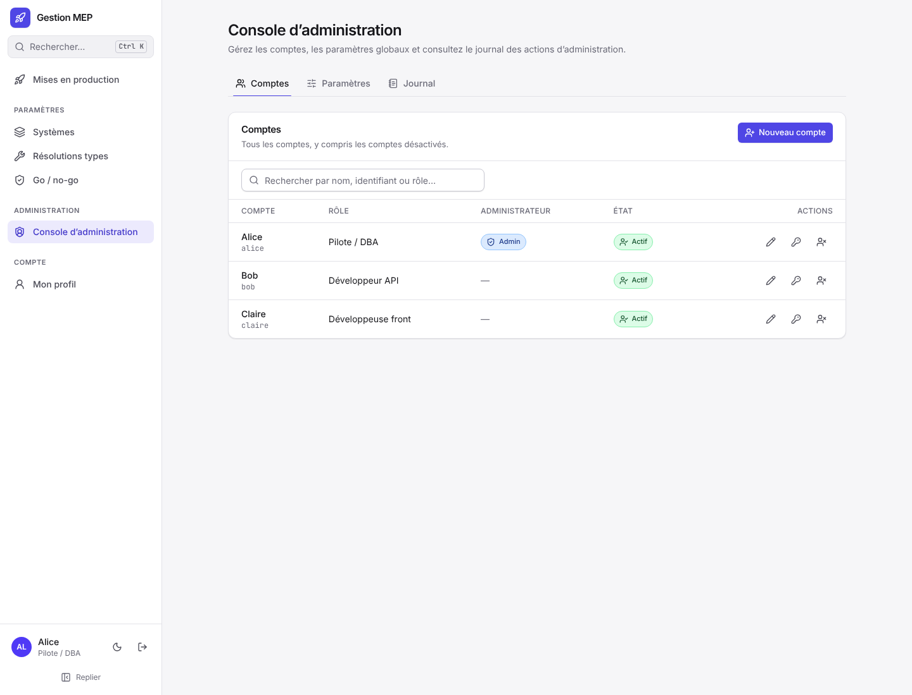

# Administrer

Cette page s'adresse aux **administrateurs** de l'application. Tout ce qui se règle dans la console d'administration se règle aussi en ligne de commande (`gestion-mep`), pour l'équipe informatique : la commande équivalente est indiquée pour chaque onglet ci-dessous, le détail est dans [Exploiter](Exploiter.md#commandes-dadministration).

Être administrateur donne accès à la console et aux paramètres globaux, mais ne donne pas les droits du pilote dans une MEP (go / no-go, retour arrière, clôture…). Voir [Droits par rôle](Droits.md).

Pour les MEP, un administrateur peut toutefois, depuis le menu « ⋯ Plus d'actions » de la MEP :

- **annuler** une MEP en préparation, même s'il ne la pilote pas (motif obligatoire) ;
- prendre le **pilotage de secours** après le Go, quand le pilote et les suppléants ne répondent plus : il prend le pilotage ou désigne un pilote, avec un motif, tracé au journal de la MEP et au journal d'administration, et un bandeau le rappelle à tous jusqu'à la clôture ;
- **supprimer définitivement** une MEP qui n'a jamais eu de Go, ou un modèle, avec un motif et le nom de la MEP saisi pour confirmer. Seule une ligne « MEP supprimée » reste au journal d'administration ; une MEP lancée s'annule à la place. Il n'y a pas de commande de suppression en ligne de commande.

Voir [Cycle de vie](Cycle-de-vie.md#annuler-une-mep).

## Le premier administrateur

Il est créé au premier démarrage, sur une base vide, à partir des variables `ADMIN_LOGIN` et `ADMIN_MOT_DE_PASSE` du fichier `.env` (voir [Installer](Installer.md)). Sans `ADMIN_MOT_DE_PASSE`, un mot de passe provisoire est écrit dans le journal de l'application. Dans tous les cas, il est à changer à la première connexion. Il crée ensuite les autres comptes.

## Console d'administration

Menu « Administration › Console d'administration », visible des seuls administrateurs. Sept onglets.

### Comptes

- **Nouveau compte** : identifiant, nom affiché, rôle (par exemple « Développeur API »), contact, case « Administrateur ».
- **Modifier**, **Réinitialiser le mot de passe**, **Désactiver**, **Réactiver**.
- **Relier un autre compte** (icône de lien) et **Défaire la liaison** : voir [Comptes d'une même personne](#comptes-dune-même-personne).
- Colonne **Équipes** et filtre « Toutes les équipes » à côté de la recherche (voir [Équipes](#équipes)).
- Badges : Admin, Actif ou Désactivé, Mot de passe à changer.

À la création et à la réinitialisation, l'application génère un **mot de passe provisoire**, affiché une seule fois. Le transmettre par un canal sûr, puis cliquer « J'ai transmis le mot de passe ». À sa connexion, l'utilisateur doit choisir son propre mot de passe (10 caractères au moins) avant de pouvoir faire quoi que ce soit.

Règles de sécurité :

- désactiver un compte ou réinitialiser son mot de passe ferme immédiatement ses sessions ;
- on ne peut pas désactiver son propre compte ;
- le dernier administrateur actif ne peut être ni désactivé ni rétrogradé ;
- un nom affiché ne peut pas reprendre le nom affiché ou l'identifiant d'un autre compte, pour que personne ne signe les journaux à la place d'un autre ; la règle vaut aussi pour un compte créé à la première connexion par Microsoft (connexion refusée, voir [Connexion Microsoft](Connexion-Microsoft.md#comment-les-comptes-sont-reliés)) ;
- les comptes ne se créent que depuis la console ou la ligne de commande (`gestion-mep comptes creer`), et le profil d'un autre compte ne se modifie que là ;
- qui est administrateur, et quel compte a un mot de passe provisoire à changer, ne se lit que dans la console : la liste des comptes que voient les autres utilisateurs (pour choisir une personne) ne le dit pas.

**Personne partie** : désactiver son compte plutôt que de le supprimer (l'application ne supprime jamais un compte). Ses données et son historique restent visibles partout : liste des comptes, personnes et approbations des MEP, journaux, exports et équipes, avec son nom et son identifiant. Le compte n'est simplement plus proposé quand on ajoute une personne à une MEP, un approbateur ou un membre d'équipe, ni dans les suggestions de responsables techniques ; s'il est déjà choisi, il reste affiché avec la mention « désactivé ».

#### Comptes d'une même personne

Une personne peut avoir plusieurs comptes : un ancien compte local et un compte créé par la connexion unique, un compte d'administration et un compte courant… On les **relie**, sans rien fusionner ni supprimer : sur la ligne du compte principal, **Relier un autre compte**, choisir l'autre compte, et cocher au besoin « Désactiver ce compte ». Le compte principal donne le **nom affiché** de la personne.

- Les comptes reliés s'affichent ensemble, le compte relié sous son compte principal (« Relié à … »). La recherche par l'identifiant ou l'ancien nom de l'un retrouve toute la personne, dans la console comme dans la liste des MEP.
- Partout ailleurs (personnes des MEP, approbations, pièces jointes, résolutions types, exports), le compte relié apparaît sous le nom de la personne. Ses nouvelles actions sont signées de ce nom ; le journal garde l'identifiant du compte utilisé, et les événements antérieurs restent tels qu'ils ont été enregistrés.
- Les équipes de la personne sont celles de tous ses comptes. Une même personne ne peut pas être désignée deux fois approbatrice avec deux comptes, ni approuver une MEP dont elle est pilote avec un autre compte.
- Chaque compte garde sa connexion et ses droits propres. Le compte relié peut rester utilisable ou être désactivé (« Désactiver ce compte », ou plus tard « Désactiver »).
- Un seul niveau : le compte principal n'est relié à aucun autre et le compte relié n'a pas lui-même de comptes reliés. **Défaire la liaison** (icône de lien barré) rend au compte son propre nom ; rien d'autre ne change.

Chaque liaison et chaque liaison défaite est inscrite au journal d'administration.

En ligne de commande : `gestion-mep comptes lister | afficher | creer | modifier | expertises | reinitialiser-mdp | desactiver | reactiver | relier | delier`, avec les mêmes règles. `comptes modifier` règle aussi les expertises d'un compte (`--ajouter-expertise BDD --detail "…"`, `--retirer-expertise BDD`).

### Équipes

Les équipes regroupent des personnes pour filtrer les listes : liste des MEP, comptes de la console, choix des personnes d'une MEP (champ « Équipe » du dialogue « Ajouter une personne ») et des approbateurs (la recherche porte aussi sur le nom des équipes). Une personne peut appartenir à plusieurs équipes. Une MEP appartient à une équipe dès qu'une de ses personnes (reliée à un compte) en fait partie, par l'un de ses comptes reliés.

- **Nouvelle équipe** : nom (unique), description, membres choisis parmi les comptes actifs.
- **Modifier** : renommer, changer la description, ajouter ou retirer des membres. Un compte désactivé reste membre tant qu'on ne le retire pas.
- **Supprimer** : seul le regroupement disparaît ; les comptes, leurs données et les MEP ne changent pas.

Chaque équipe a aussi un **contact support** et une **signature**, repris par ses [modèles de texte](Modèles-de-texte.md) ; ses membres et les administrateurs les règlent dans Paramètres › Modèles de texte. Une nouvelle équipe reçoit une copie des quatre modèles fournis.

Toute création, modification (avec les membres ajoutés et retirés) et suppression est inscrite au journal d'administration. Les équipes se lisent par tout utilisateur connecté (pour les filtres) ; seuls les administrateurs les modifient.

En ligne de commande : `gestion-mep equipes lister | afficher | creer | modifier | ajouter | retirer | supprimer`, et `gestion-mep meps lister --equipe <équipe>`.

### Connexion unique

Connexion Microsoft (SSO) facultative : adresse de retour à déclarer dans Microsoft Entra, ID de l'annuaire, ID d'application, secret client (chiffré, jamais réaffiché, effacé si l'annuaire ou l'application change) et sa date d'expiration, création automatique des comptes, rôle d'application qui donne le rôle administrateur. **Tester** vérifie les réglages auprès de Microsoft sans connecter personne ; **Activer** affiche le bouton sur la page de connexion, sans redémarrage. La liste « Comptes liés » permet de supprimer une liaison. Le pas-à-pas pour l'équipe informatique est dans [Connexion Microsoft](Connexion-Microsoft.md).

En ligne de commande : `gestion-mep sso afficher | configurer | tester | activer | desactiver | comptes | delier`.

### Paramètres

- **Nombre minimum d'approbations** exigées avant le Go (0 = aucune).
- **Réglages du serveur**, appliqués sans redémarrage : adresse publique, réseaux du reverse proxy, HTTPS obligatoire, tailles et plafonds des pièces jointes, compression des pièces jointes (avec la place qu'elles occupent, voir [Exploiter](Exploiter.md#compression-des-pièces-jointes)), tentatives de connexion par minute, écrans suivis en temps réel, vérification des nouvelles versions, lien « Signaler un problème ou une idée ». Chaque réglage indique d'où vient sa valeur : fichier `.env`, valeur par défaut, ou modifiée dans la console (date et auteur). **Rétablir** revient à la valeur du fichier `.env`. Les mêmes réglages se modifient en ligne de commande (`gestion-mep reglages`, voir [Exploiter](Exploiter.md#modifier-un-réglage)).
- Rappel des réglages lus seulement au démarrage (port, adresse d'écoute, base de données, démonstration…), à changer dans le fichier `.env`.
- Lien vers les critères go / no-go.

En ligne de commande : `gestion-mep reglages lister | definir <nom> <valeur> | retablir <nom>` (dont `reglages definir approbations-minimum 2`), `gestion-mep criteres lister | ajouter | modifier | supprimer` pour les critères go / no-go, et `gestion-mep config afficher` pour les réglages lus au démarrage (secrets masqués).

### Charte visuelle

Couleurs de l'application **pour tous les utilisateurs**, en thème clair et en thème sombre, et des classeurs Excel exportés. Rien d'autre ne change : ni le logo, ni le nom de l'application, ni les polices.

- **Primaire** : boutons principaux, liens, onglet et menu actifs, contour de focus ; en-têtes de tableau et liens des exports Excel.
- **Secondaire** : panneau de la page de connexion, menu latéral s'il est coloré, titres des exports Excel.
- **Tertiaire** : sections du plan, entrées et sorties du graphe, mises en avant. Par défaut « Identique à la primaire ».
- **Gris** : froids (par défaut), purs, chauds, ou teintés d'une nuance de la primaire (fonds, bordures, textes discrets).
- **Menu latéral** : « Comme les pages » (par défaut) ou « Secondaire ».
- **Couleurs d'état** (panneau replié) : réussie, avertissement (résolution), échec, en cours. À changer avec prudence : elles portent le sens du déroulé d'une MEP.

Un clic sur une pastille ouvre le sélecteur : zone de couleur, teinte, saisie HEX, RVB ou TSL, pipette (selon le navigateur), contraste du texte blanc et sur fond blanc, couleurs de la charte, suggestions et couleurs récentes. La couleur du **thème sombre** est calculée (même teinte, plus claire, textes vérifiés sur fond sombre) ; **Retoucher** en impose une autre, **Revenir au calcul** annule.

La carte **Lisibilité (WCAG AA)** contrôle chaque changement dans les deux thèmes : 4,5:1 pour les textes, 3:1 pour les cadres et le contour de focus. **Corriger** garde la teinte et propose la luminosité la plus proche qui passe. Elle prévient aussi quand la primaire ou la tertiaire ressemble à une couleur d'état (un bouton se lirait comme un état de la MEP). Le texte posé sur une couleur d'état pleine (pastille, compteur, bouton « Approuver ») s'écrit en blanc ou en encre foncée, selon ce qui se lit le mieux : la ligne **Texte sur la couleur « … » pleine** signale une couleur où ni l'un ni l'autre n'atteint 4,5:1, et **Corriger** l'assombrit juste assez. Ce ne sont que des avertissements : rien n'est bloqué.

L'**aperçu** montre l'application (clair ou sombre) et un classeur Excel avec la charte en cours de réglage. Rien ne change pour personne avant **Enregistrer** ; ensuite, la charte s'applique dans la minute à tous les écrans ouverts, sans recharger.

- **Exporter** télécharge la charte affichée au format `charte.json` ; **Importer…** reprend un fichier exporté d'une autre installation ou préparé à la main (le fichier est vérifié, les couleurs actuelles et importées sont comparées ; rien n'est enregistré avant « Enregistrer »).
- La charte enregistrée dans la console **remplace** le fichier `charte.json` posé par l'équipe informatique (voir [Exploiter](Exploiter.md#charte-visuelle)). **Charte par défaut** l'efface après confirmation : le fichier s'applique de nouveau s'il existe, sinon les couleurs d'origine.
- Un fichier `charte.json` invalide est ignoré (charte par défaut) et signalé en haut de l'onglet, avec la ligne en cause.

Chaque enregistrement et chaque retour à la charte par défaut est inscrit au journal d'administration, avec les couleurs changées.

En ligne de commande : `gestion-mep charte afficher | exporter | importer | verifier | definir | retablir`.

### Journal

Les 200 derniers événements d'administration : comptes créés, modifiés, désactivés, réactivés, renommés par leur titulaire, reliés à un autre compte de la même personne ou déliés, équipes créées, modifiées ou supprimées, mots de passe réinitialisés ou changés, paramètres, réglages du serveur, charte visuelle et critères go / no-go modifiés, réglages de la connexion unique, comptes liés ou déliés, comptes créés à la première connexion par Microsoft, premières connexions refusées parce que le nom donné par Microsoft est déjà celui d'un autre compte, systèmes du catalogue ajoutés, modifiés, désactivés ou supprimés, environnements, catégories et objets de leur fiche modifiés, catégories par défaut modifiées, résolutions types supprimées, désactivées ou importées, modèles de recette et étapes modèles supprimés, modèles de texte créés, modifiés, rétablis ou supprimés, MEP exportées en ligne de commande, MEP supprimées (avec leur nom et le motif), pilotages de secours (MEP, ancien et nouveau pilote, motif), mises à jour demandées, contrôles des données après une mise à jour ou une importation, réinitialisation de la démonstration. Chaque auteur est suivi de son identifiant, qui ne change jamais. Les actions faites en ligne de commande y apparaissent avec l'auteur « Ligne de commande ».

L'application y signale aussi, avec l'auteur « Application », **20 échecs de connexion en moins d'une heure sur un même compte**, toutes adresses confondues : signe probable qu'on essaie de deviner son mot de passe.

En ligne de commande : `gestion-mep journal [--depuis AAAA-MM-JJ] [--limite n]` (`--json` pour un script).

### Version

Version en cours, dernière version publiée sur GitHub et date de la dernière vérification. Quand une version plus récente existe, la barre latérale affiche « Mise à jour … disponible » et l'onglet donne le lien vers ses nouveautés. « Vérifier maintenant » interroge GitHub sans attendre.

Si l'équipe informatique a activé le service de mise à jour, le bouton **« Mettre à jour vers … »** installe la nouvelle version après confirmation : l'application redémarre (les personnes connectées sont déconnectées environ une minute), une sauvegarde est faite avant toute migration, et la version actuelle est remise si la nouvelle ne démarre pas. Le bouton est refusé tant qu'une MEP est en cours. Sans ce service, l'onglet renvoie à la marche à suivre manuelle ([Mettre à jour](Exploiter.md#mettre-à-jour)).

L'onglet rappelle aussi le lien « Signaler un problème ou une idée », proposé à tout le monde dans le menu utilisateur.

En ligne de commande : `gestion-mep version`, `gestion-mep mettre-a-jour` (vérifie la dernière version publiée) et `gestion-mep mettre-a-jour --oui` (même demande que le bouton, mêmes refus).

## Mode démonstration

Avec `DEMO=true` dans `.env` (jamais sur un serveur partagé), l'application l'indique partout par un bandeau **« Mode démonstration — données fictives, réinitialisables »**, en haut de chaque page, écran de connexion compris. L'écran de connexion propose aussi une **connexion rapide** : un clic sur `alice`, `bob` ou `claire` ouvre sa session, sans mot de passe à saisir. Seuls ces trois comptes, et tant qu'ils gardent le mot de passe `demo`, sont acceptés : un compte créé dans la console, même administrateur, ne l'est jamais. La liste des MEP de démonstration et de ce qu'elles permettent d'essayer est dans [Démarrage rapide](Démarrage-rapide.md#mep-de-démonstration).

Un administrateur voit dans le bandeau le bouton **« Réinitialiser la démonstration »**. Après confirmation, la base revient exactement à son état initial : comptes, MEP, catalogue, résolutions types, critères, paramètres, réglages du serveur et journaux sont recréés, les pièces jointes supprimées. Tout le monde est déconnecté ; l'auteur revient à l'écran de connexion. Le journal d'administration repart de la seule ligne « Démonstration réinitialisée par … ».

Toute personne connectée voit aussi **« Simuler des collègues »** : Bob et Claire se connectent pour de vrai à la MEP « Facturation électronique » (en préparation) et y travaillent quelques minutes à un rythme lisible : ils entrent dans une section, ouvrent une étape (verrou), modifient un texte, ajoutent puis déplacent une étape, et prennent la main sur une étape que quelqu'un d'autre a ouverte. Tout passe par les règles, le temps réel et le journal habituels ; aucune autre MEP n'est touchée. **« Arrêter la simulation »**, ou la fin du délai, les fait partir (verrous relâchés, étapes de passage retirées). La réinitialisation arrête d'abord la simulation.

En ligne de commande : `gestion-mep demo reinitialiser --oui` (voir [Exploiter](Exploiter.md#mode-démonstration)). Sans `DEMO=true`, ni le bandeau, ni la connexion rapide, ni la réinitialisation n'existent.

## Paramètres partagés

Le menu « Paramètres » est visible de tous, en lecture seule pour les non-administrateurs, sauf les résolutions types et les bibliothèques d'étapes et de recettes.

| Page | Contenu | Qui modifie |
|---|---|---|
| Systèmes | Catalogue des systèmes de l'entreprise (nom, description, cible), avec leurs environnements, le nombre d'objets connus et la **dernière MEP** qui les a touchés (lien vers leur historique). Le lien de chaque système ouvre sa **fiche** (onglet « Fiche ») : ses **environnements** (nom, cible, production ou non, déduit du nom tant qu'on ne coche pas la case) et ses **catégories** d'objets (tables, vues, traitements…) avec leurs **objets** (type, nom, libellé, précision), seuls proposés dans les MEP. « Ajouter une catégorie » suggère les **catégories par défaut**, réglées pour tous les systèmes par le bouton du même nom. Retirer une catégorie retire ses objets de la fiche, pas des MEP qui les ont déjà choisis. Un système déjà utilisé par une MEP est désactivé au lieu d'être supprimé. L'onglet **« Historique des MEP »** de la fiche, ouvert à tous, liste les MEP qui l'ont touché (voir [Historique d'un système](Suivre-une-MEP.md#historique-dun-système)). | Administrateurs (l'historique : tout le monde) |
| Résolutions types | Fiches de dépannage réutilisables, avec l'historique de leurs versions. Une fiche déjà utilisée est désactivée au lieu d'être supprimée. | Tout le monde crée et modifie ; les administrateurs suppriment |
| Bibliothèque d'étapes | Étapes modèles par système du catalogue (un ou plusieurs), insérées par copie dans le plan des MEP (voir [Préparer une MEP](Préparer-une-MEP.md#la-bibliothèque-détapes)). Un système du catalogue utilisé par une étape modèle est désactivé au lieu d'être supprimé ; une résolution type liée à une étape modèle aussi. | Tout le monde crée et modifie ; les administrateurs suppriment |
| Bibliothèque de recettes | Modèles de fiches de recette par système du catalogue, insérés par copie dans les MEP (voir [Préparer une MEP](Préparer-une-MEP.md#la-bibliothèque-de-recettes)). | Tout le monde crée et modifie ; les administrateurs suppriment |
| Go / no-go | Critères à cocher avant chaque Go, et nombre minimum d'approbations. | Administrateurs |
| Modèles de texte | Courriels types de chaque équipe (annonce, rappel, demande de MEP, compte rendu), contact support et signature de l'équipe (voir [Modèles de texte](Modèles-de-texte.md)). | Membres de l'équipe et administrateurs ; les modèles fournis ne se suppriment pas |

En ligne de commande : `gestion-mep systemes lister | afficher | ajouter | modifier | supprimer | environnement | categorie | objet`, `gestion-mep categories lister | ajouter | retirer`, `gestion-mep resolutions lister | afficher | supprimer | exporter | importer` (import contrôlé fiche par fiche, avec un essai à blanc possible) et `gestion-mep criteres …`. Les MEP se listent et s'exportent en JSON, avec leur journal, pour l'archive ou un audit : `gestion-mep meps lister | exporter`.

## Profils

Chaque utilisateur gère son profil dans « Mon profil » : nom affiché, rôle, contact, **expertises** (systèmes du catalogue, avec un détail comme « Expert de la zone facturation ») et mot de passe. Quand la connexion unique est active, « Lier mon compte » relie un compte local à son compte Microsoft ; ensuite le bouton « Se connecter avec Microsoft » ouvre ce compte. Les expertises servent à suggérer des responsables techniques lors de la préparation d'une MEP.
