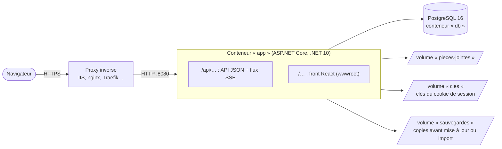

# Architecture

Cette page décrit comment l'application est construite, pour un développeur qui reprend le code. Le contrat d'API est décrit dans [API](API.md), l'installation dans [Installer](Installer.md) et les conventions de développement dans [Contribuer](../CONTRIBUTING.md).

## Vue d'ensemble

- **Une seule image Docker** contient l'API et le front déjà construit : l'API sert les fichiers statiques et renvoie `index.html` pour toute route qui n'est pas sous `/api`.
- **PostgreSQL** est la seule dépendance externe. Le schéma est migré automatiquement au démarrage (EF Core), après une sauvegarde automatique contrôlée (voir [Exploiter](Exploiter.md#mettre-à-jour)).
- **Pièces jointes** : fichiers sur disque (volume Docker), métadonnées en base.
- **Instance unique** : le flux temps réel est diffusé en mémoire et les migrations tournent au démarrage. Pour plusieurs instances, il faudrait remplacer `DiffuseurMep` par `LISTEN/NOTIFY` PostgreSQL et sortir les migrations du démarrage.

## Back-end

Deux projets dans `backend/src`, testés par `backend/tests/GestionMep.Tests`.

### `GestionMep.Domain` : modèle et règles métier

Aucune dépendance vers ASP.NET ni EF Core.

- `Modele.cs` : entités (`Mep`, `Etape`, `Participant`, `Systeme`, `ResolutionType`, `FicheRecette`, `Approbation`…) et énumérations.
- `Regles.cs` et `Regles.*.cs` : toutes les règles, en fonctions statiques pures d'une même classe partielle, un fichier par domaine (`Regles.Graphe.cs`, `Regles.Disponibilite.cs`, `Regles.Droits.cs`, `Regles.Phases.cs`, `Regles.Recette.cs`, `Regles.Resolutions.cs`…). Elles couvrent la disponibilité d'une étape, la validité du graphe, la vérification du plan, les transitions de phase, les approbations, le go / no-go, le point de non-retour, la recette, le retour arrière, les résolutions types et la duplication.
- Un refus lève `RegleMetierException` avec un message en français destiné à l'utilisateur. L'API le traduit en **422**.
- L'heure courante est toujours passée en paramètre (`maintenant`) : les règles se testent sans horloge.
- `DonneesDemo.cs` : jeu de démonstration (comptes `alice`, `bob`, `claire`, MEP d'exemple).

### `GestionMep.Api` : API HTTP

| Dossier | Rôle |
|---|---|
| `Program.cs` | Composition : services, middlewares, montage des groupes de routes, amorçage. |
| `Endpoints/` | Une classe statique par domaine (`MapMeps`, `MapEtapes`, `MapPhase`…), en Minimal API. Toutes les routes sont sous `/api` et exigent une session, sauf la connexion, `/api/sante` et `/api/version`. |
| `Cli/` | Commande `gestion-mep` (`LigneDeCommande*.cs`) : administration et exploitation sans navigateur. Elle appelle les opérations publiques des classes `Endpoints/` (`AdminEndpoints.Modifier`, `CatalogueEndpoints.Supprimer`, `ResolutionsEndpoints.Appliquer`…), partagées avec les routes de la console : mêmes règles, même journal d'administration (acteur absent : auteur « Ligne de commande »). |
| `Services/ServiceMep.cs` | Chargement d'une MEP (avec application de l'échéance de retour arrière), contrôle de version, journal d'audit, enregistrement et notification. |
| `Services/MepMapping.cs` | Seul endroit où une entité devient un DTO : calcul des disponibilités, des erreurs du plan et des droits de l'utilisateur courant. |
| `Services/Dtos.cs` | Contrats d'entrée (`…Saisie`) et de sortie (`…Dto`). |
| `Services/DocumentationOpenApi.cs` | Description OpenAPI servie sur `/api/openapi.json`, copiée dans `docs/openapi.json` pour générer les types du front. |
| `Services/ErreurHttp.cs` | Erreurs HTTP explicites et middleware qui traduit les exceptions en `{ "message": "…" }`. |
| `Services/DiffuseurMep.cs` | Diffusion en mémoire de la dernière version de chaque MEP aux abonnés du flux SSE. |
| `Services/SurveillanceEcheances.cs` | Tâche de fond : chaque minute, bascule en retour arrière les MEP dont l'échéance est atteinte. |
| `Services/StockagePiecesJointes.cs` | Écriture, lecture et suppression des fichiers joints ; fichiers sans enregistrement en base mis de côté au démarrage. |
| `Services/MisesAJour.cs` | Version en cours, vérification des versions publiées sur GitHub et dialogue avec le service facultatif de mise à jour (fichiers dans un volume partagé). |
| `Services/Sauvegardes.cs` | Archive de la base (COPY binaire par table) et des pièces jointes ; sauvegarde avant migration ou importation, contrôle qu'aucune donnée n'est perdue, puis suppression de la sauvegarde. |
| `Services/EchangeResolutions.cs` | Format JSON d'export des résolutions types et importation contrôlée fiche par fiche (`gestion-mep resolutions exporter / importer`). |
| `Securite/` | Protections HTTP : en-têtes du proxy inverse, limite des tentatives de connexion (par IP et par compte), en-tête anti-CSRF exigé, en-têtes de sécurité (CSP…), taille maximale des requêtes, sonde `--sante` de l'image Docker. |
| `Auth/` | Comptes locaux, cookie de session, `Acteur` (utilisateur courant), connexion unique OpenID Connect (`ConnexionUnique.cs`). |
| `Donnees/` | `MepDbContext`, migrations EF Core, `Amorcage` (migration précédée d'une sauvegarde, démonstration ou compte administrateur initial). |

### Déroulé d'une requête d'écriture

1. Le handler passe par `ServiceMep.Modifier`, qui charge la MEP par `ServiceMep.Charger` (celui-ci applique d'abord l'échéance de retour arrière si elle est dépassée) puis exécute les étapes 2 à 4, rejouables en cas d'écriture simultanée (voir Concurrence).
2. Il vérifie les droits (`ServiceMep.ExigerEditeur`, `Regles.EstPilote`…) et la version envoyée par le client (`ExigerVersion`, `ExigerRevision`).
3. Il appelle une ou plusieurs fonctions de `Regles`, qui modifient l'entité ou lèvent `RegleMetierException`.
4. `ServiceMep.Enregistrer` incrémente la version, ajoute l'événement au journal, enregistre, puis notifie le flux SSE.
5. La réponse est **la MEP complète** (`MepDto`), recalculée pour l'utilisateur courant. Le front remplace son état par cette réponse.

### Concurrence

- Chaque MEP porte un numéro de `Version`, chaque étape une `Revision`. Le client renvoie celui qu'il a lu ; un écart donne **409** et le front recharge.
- EF Core utilise aussi la `Version` de la MEP (et celle des résolutions types) comme jeton de concurrence, ce qui protège deux écritures simultanées sur le serveur.
- **Réessai automatique** : toute écriture sur une MEP passe par `ServiceMep.Modifier`. Si l'enregistrement échoue seulement parce qu'une autre écriture vient de passer sur la même MEP (`DbUpdateConcurrencyException` sur `Mep.Version`, ou clé unique prise entre-temps), le serveur vide le suivi EF (`ChangeTracker.Clear()`), relit la MEP, revérifie toutes les préconditions (droits, révision de l'étape, version envoyée par le client, règles du domaine) et rejoue l'action, jusqu'à 3 essais espacés de quelques millisecondes aléatoires, puis répond 409 comme avant. Des personnes qui agissent en même temps sur des étapes différentes d'une MEP en exécution réussissent donc toutes.
- **Ce qui reste un vrai conflit (409)** : une étape modifiée depuis sa lecture (révision périmée, par exemple deux démarrages simultanés de la même étape : un seul aboutit), une MEP modifiée depuis sa lecture sur les routes qui exigent sa `version` (fiche de la MEP, plan de retour arrière, sauvegarde, approbateurs, approbation…), ou, rarement, plus de trois écritures simultanées sur la même MEP (essais épuisés pour la dernière).
- Une action rejouée ne doit pas avoir d'effet hors base : le journal et les entités ajoutés sont annulés par `ChangeTracker.Clear()`, la notification SSE n'est envoyée qu'après un enregistrement réussi, le fichier d'une pièce jointe est écrit une seule fois avant l'enregistrement (et effacé s'il échoue définitivement), les fichiers supprimés ne le sont qu'après le succès.

### Codes d'erreur

| Code | Sens |
|---|---|
| 400 | Saisie invalide (champ manquant, JSON mal formé). |
| 401 | Pas de session. |
| 403 | Droit insuffisant. |
| 404 | Ressource introuvable. |
| 409 | Conflit de version : la ressource a changé depuis sa lecture. |
| 413 | Fichier ou requête trop volumineux. |
| 429 | Trop de tentatives de connexion. |
| 422 | Refus par une règle métier. |

### Base de données

- PostgreSQL via Npgsql. Les listes et petits objets attachés à une entité (dépendances, systèmes d'une étape, responsables techniques, expertises…) sont stockés en `jsonb` via `AsJson` / `AsJsonObjet` (`MepDbContext.cs`).
- Les migrations sont dans `Donnees/Migrations`. Voir [Contribuer](../CONTRIBUTING.md#créer-une-migration) pour en créer une.

### Authentification

- Comptes locaux, mots de passe hachés par `PasswordHasher` (PBKDF2), cookie `HttpOnly` `SameSite=Lax`, `Secure` hors développement. Les clés qui chiffrent le cookie sont conservées dans un volume (`Cles:Dossier`) : un redéploiement ne déconnecte personne.
- Connexion limitée par adresse IP (fenêtre d'une minute) ; `LimiteurConnexion` bloque un login quelques minutes depuis une adresse après 5 échecs consécutifs, signale 20 échecs en une heure sur un login (journal d'administration), borne sa mémoire et le nombre de hachages simultanés. Login et mot de passe démesurés sont refusés sans calcul.
- Ressources bornées : `QuotasPiecesJointes` (total par MEP, dépôts d'un compte sur 24 heures, espace disque minimal, réservations en mémoire pour les dépôts simultanés) ; `DiffuseurMep` (flux temps réel par compte et pour le serveur, renouvelés toutes les heures).
- Toute requête `/api` qui modifie doit porter l'en-tête `X-Requested-With` (protection CSRF) ; le front l'ajoute toujours.
- Toutes les réponses portent une politique de contenu (CSP) qui interdit l'affichage dans un cadre, ainsi que `nosniff` et `Referrer-Policy`. Les corps de requête sont limités à 1 Mo, sauf sur les routes de dépôt de pièces jointes.
- Le reste de l'API ne lit que les claims `NameIdentifier`, `Name` et `Role` via `Acteur.Depuis(user)`.
- Connexion unique facultative (`Auth/ConnexionUnique.cs`) : gestionnaire OpenID Connect d'ASP.NET Core (code + PKCE, retour sur `/connexion-sso/retour`). Ses réglages sont une ligne de la table `ConfigurationsSso`, modifiée par la console ou `gestion-mep sso` ; `ReglagesSso` la relit au départ vers le fournisseur et au retour, et vide le cache des options OpenID Connect quand elle a changé : pas de redémarrage. Le secret est chiffré par Data Protection (mêmes clés que le cookie) et effacé quand l'émetteur ou l'ID d'application change, pour qu'il ne parte jamais vers un autre fournisseur ; le test refuse un point de jeton hors https (et hors `login.microsoftonline.com` pour Entra ID) et ne suit pas les redirections. Au retour, `ConnexionUnique.Resoudre` retrouve le compte par émetteur + `oid`/`sub` (table `IdentitesExternes`), le relie (liaison depuis le profil, jeton à durée limitée propre à la session) ou le crée, puis émet le même cookie qu'une connexion locale.

## Front-end

React 19 + TypeScript 7 + Vite, Tailwind CSS 4 et primitives Radix. Le détail des commandes et des dossiers est dans [frontend/README.md](../frontend/README.md).

- Une page par route (`src/pages`, `src/parametres`), les onglets d'une MEP dans `src/mep`.
- La logique pure (graphe, disponibilité, recherche, blocs d'instructions, formats) est isolée dans des modules testés sans DOM : `graphe.ts`, `domaine.ts`, `recherche.ts`, `blocs.ts`, `format.ts`.
- Toute action passe par `MepContext.run`, qui appelle l'API, remplace la MEP par la réponse et gère les conflits.
- Temps réel : un `EventSource` par MEP ouverte reçoit la nouvelle version, et le front recharge la MEP si elle est plus récente que la sienne. Une saisie en cours n'est jamais écrasée : un bandeau propose de recharger.

## Tests

| Projet | Contenu | Commande |
|---|---|---|
| `backend/tests` | Règles métier (sans base) et API de bout en bout sur une vraie base PostgreSQL (`WebApplicationFactory`) | `cd backend && dotnet test` |
| `frontend` | Logique pure et composants (Vitest + Testing Library, jsdom) | `cd frontend && npm test` |

## Intégration continue

`.github/workflows/ci.yml` lance les tests back (avec un service PostgreSQL) et front à chaque PR et à chaque fusion sur `main`. Sur `main`, il construit et publie l'image sur `ghcr.io/soladevsolide/gestion-mep` (étiquettes `main` et `sha-…`). Une étiquette Git `vX.Y.Z` publie la version numérotée (`X.Y.Z`, `X.Y`, `latest`), puis crée la version GitHub avec ses notes, que l'indicateur de mise à jour de l'application consulte. Le job `archives` construit, à chaque PR comme à chaque version, les archives autonomes de l'[installation sans Docker](Installer-sans-Docker.md) (`.github/scripts/archives.sh` : `dotnet publish` pour `linux-x64` et `win-x64`, le front dans `wwwroot`, et les scripts du dossier `installation/`) ; elles sont jointes à la version GitHub. Le type d'installation (`docker`, `linux` ou `windows`, renvoyé par `GET /api/application`) adapte les commandes affichées par la console et par `gestion-mep`. Le service facultatif de mise à jour (`mise-a-jour/`, un script shell sur l'image Docker CLI) est publié avec les mêmes étiquettes sur `ghcr.io/soladevsolide/gestion-mep-mise-a-jour`.
