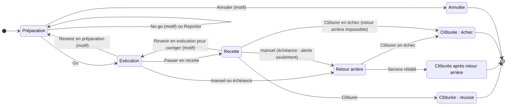
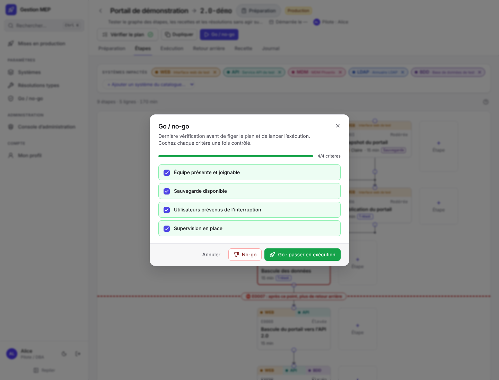

# Cycle de vie d'une MEP

Une MEP passe par cinq phases, et peut s'arrêter en route : **annulée** depuis la préparation, ou **clôturée en échec** quand ni la recette ni le retour arrière n'ont rétabli le service. Seuls le **pilote** et ses **suppléants** la font changer de phase ; un administrateur qui n'est ni pilote ni suppléant peut seulement l'annuler, prendre le [pilotage de secours](#pilotage-de-secours-et-passation) ou la supprimer si elle n'a jamais eu de Go. Le détail de chaque droit est dans [Droits par rôle](Droits.md).

> [!IMPORTANT]
> Une fois le **point de non-retour** franchi, les flèches vers « Retour arrière » et « Préparation » disparaissent : on ne peut plus que corriger en avant (étapes correctives), passer en recette, et en dernier recours clôturer en échec.

Les actions rares sont dans le menu **« ⋯ Plus d'actions »** de l'en-tête de la MEP : reporter, annuler, passer le pilotage, pilotage de secours et, pour un administrateur, supprimer définitivement. Une action impossible y reste visible, grisée, avec la raison (« Revenir d'abord en préparation », « Impossible après un Go : annuler plutôt »).

## Préparation

L'équipe décrit l'intervention (voir [Préparer une MEP](Préparer-une-MEP.md)). Le bouton « Vérifier le plan » liste les **anomalies**, qui empêchent de démarrer, et les **avertissements**, qui ne l'empêchent pas.

Toute modification du contenu efface les approbations déjà données : les approbateurs doivent relire et se prononcer de nouveau. Elle efface aussi la case **« Procédure relue »** : le plan modifié est à relire. Les deux effacements sont tracés au journal (« Approbations à refaire », « Relecture de la procédure à refaire »). Changer la liste des approbateurs ou l’échéance de retour arrière efface les décisions, mais pas la relecture.

**Séparation des tâches** : le pilote, ses suppléants et les responsables techniques ne peuvent pas approuver la MEP, même avec un compte relié au leur (voir [Droits par rôle](Droits.md#les-rôles)).

**Résolutions types figées** : à la première approbation (au plus tard au Go), l'application fige dans la MEP une copie des résolutions types liées aux étapes (titre, contenu et version), tracée au journal. Le jour J, le déroulé applique cette copie : une modification ultérieure de la bibliothèque ne change pas ce qui a été approuvé. La copie est effacée avec les approbations quand la MEP est modifiée, puis refigée à l'approbation suivante.

## Go / no-go : passage en exécution

Le pilote ou un suppléant ouvre « Go / no-go ». Le Go n'est possible que si :

- le plan ne présente plus aucune anomalie, approbations comprises : il faut le nombre minimum d'approbations, aucun refus, et aucun approbateur qui soit pilote, suppléant ou responsable technique (même si ses données sont conservées, le Go explique qui retirer) ;
- chaque résolution type liée existe encore, est active et complète ;
- tous les critères go / no-go sont cochés (par exemple « Équipe présente et joignable », « Sauvegarde disponible ») ;
- la MEP n'est pas un modèle.

Les critères cochés sont enregistrés avec la MEP. Un **no-go** exige un motif : la MEP reste en préparation et le journal garde la trace de la décision. La fenêtre du no-go propose aussi de **reporter la MEP** dans la foulée (case « Reporter la MEP », date visée facultative). Le moment du Go devient la date de début de la MEP ; le Go lève un report en cours.

## Reporter une MEP

Une MEP **reportée** reste en préparation : le plan, les personnes et les approbations sont conservés, et l'équipe peut continuer à la préparer. Le pilote ou un suppléant la reporte depuis le menu « ⋯ » (« Reporter la MEP… ») ou depuis le no-go, avec un **motif obligatoire** et une **date visée facultative** (indicative : le Go reste la décision du pilote).

- La pastille devient « Reportée · 05/11/2026 » (ou « Reportée » sans date), et un bandeau visible de tous rappelle qui l'a reportée, quand et pourquoi.
- Un nouveau report remplace le précédent (« Modifier le report… »).
- Le report se lève avec **« Reprendre la préparation »**, ou par le Go.
- Une MEP reportée n'apparaît plus dans les MEP prévues du Suivi en direct ; dans la recherche, l'état « Reportée » la distingue de « Préparation ».

## Annuler une MEP

Le pilote, un suppléant ou un administrateur (même s'il ne pilote pas la MEP) l'**annule** depuis le menu « ⋯ » (« Annuler la MEP… »). L'annulation est **définitive** et ne se fait que **depuis la préparation** : après un Go, il faut d'abord « Revenir en préparation ». Le **motif** est obligatoire ; si la MEP a déjà eu un Go, l'**état laissé en production** l'est aussi, et la fenêtre liste les étapes déjà exécutées, que l'annulation ne défait pas.

Une MEP annulée :

- passe en **lecture seule** (pastille grise « Annulée ») et garde son journal ; un bandeau rappelle qui l'a annulée, quand, pourquoi et l'état laissé en production ;
- reste dans la liste, la recherche (état « Annulée », groupe « Arrêtées ») et l'historique des systèmes : elle n'est pas masquée par défaut ;
- se **duplique** pour être reprogrammée ;
- ne compte ni dans le Suivi en direct ni dans les MEP en cours.

Un modèle ne s'annule pas : un administrateur peut le supprimer.

## Exécution

Les opérateurs déroulent le plan de déploiement (voir [Exécuter une MEP](Exécuter-une-MEP.md)). Pendant cette phase :

- un compte à rebours affiche le temps restant avant l'**échéance de retour arrière**, si la MEP en a une, à l'heure du fuseau de la MEP. Le pilote peut la **reporter** (« Modifier l'échéance », motif obligatoire, ancienne et nouvelle valeur au journal) ;
- le pilote peut **revenir en préparation**, avec un **motif obligatoire**, tant qu'aucune étape ni résolution n'est en cours et que le point de non-retour n'est pas franchi. L'heure du **premier Go** est conservée (rapport de fin, annulation, suppression impossible) ;
- le pilote ou un suppléant ajoute des **étapes correctives** (« Ajouter une étape corrective ») : elles prennent les codes suivants, attendent les dernières étapes du plan, portent la mention « Ajoutée après le Go » et sont comptées dans le rapport de fin ;
- le pilote passe **en recette** quand toutes les étapes de déploiement ont réussi.

## Point de non-retour

Une étape peut être marquée point de non-retour (par exemple une bascule de données irréversible). Pour la démarrer, il faut l'accord préalable du pilote ou d'un suppléant (« Autoriser le passage »). Dès qu'elle a démarré :

- le retour arrière n'est plus possible, ni manuel, ni automatique : on corrige en avant ;
- l'échéance ne s'applique plus ;
- on ne peut plus revenir en préparation.

## Recette

Les fiches de recette sont déroulées système par système : chaque étape de test est déclarée « Conforme » ou « Non conforme », avec une observation, dans l'application ou dans le classeur Excel de la recette réimporté par le pilote. Le pilote clôture la MEP comme **réussie** quand toutes les étapes de test sont conformes. Il peut faire refaire un test.

**Échéance atteinte pendant la recette** : aucun retour arrière automatique. Un bandeau « Échéance de retour arrière dépassée » s'affiche dans l'onglet Recette et une ligne « Système » est écrite au journal, une seule fois ; le compte à rebours affiche « ÉCHÉANCE DÉPASSÉE ». Le pilote décide : déclencher le retour arrière (manuel), ou reporter l'échéance avec un motif. Tant qu'elle n'est pas reportée, revenir en exécution est impossible.

### Corriger en avant

Quand la recette révèle un problème, le cadre « Décision du pilote » de l'onglet Recette propose **« Revenir en exécution pour corriger »** (motif obligatoire). La MEP repasse en exécution : le pilote ou un suppléant y ajoute des étapes correctives, les déroule, puis repasse en recette. Les tests en échec redeviennent « à faire » ; leur historique reste au journal. C'est la seule issue propre une fois le point de non-retour franchi.

## Retour arrière

Le retour arrière arrête le plan de déploiement et ouvre le plan de retour arrière. Il se déclenche :

- **à la main**, par le pilote ou un suppléant, avec un motif, en exécution ou en recette ;
- **automatiquement**, quand l'échéance de retour arrière est atteinte **pendant l'exécution**. En recette, l'échéance atteinte est seulement signalée (voir [Recette](#recette)).

L'échec d'une correction ou de la vérification finale d'une résolution guidée ne déclenche **pas** le retour arrière : l'étape reste en échec, le journal le note, et le pilote décide (« Déclencher le retour arrière » ou « Autoriser une nouvelle tentative »).

Le déclenchement automatique est attribué à « Système » dans le journal. Aucun retour arrière n'est possible une fois le point de non-retour franchi, ni pour une MEP sans plan de retour arrière (case « Plan de retour arrière » décochée, voir [Préparer une MEP](Préparer-une-MEP.md#retour-arrière-facultatif)) : tout problème s'y corrige en avant. Sans échéance, le déclenchement automatique disparaît.

L'échéance se modifie en préparation, en exécution et en recette (« Modifier l'échéance » dans « Intervention »), à l'heure du fuseau de la MEP. Un motif est obligatoire (sauf à la première saisie en préparation) et le journal garde l'ancienne et la nouvelle valeur. Elle ne se modifie plus une fois le retour arrière déclenché, ni sur une MEP clôturée ou annulée. Une nouvelle échéance doit être dans le futur.

Quand toutes les étapes de retour arrière ont réussi, le pilote clôture avec « Service rétabli : clôturer » : la MEP est **clôturée après retour arrière**.

## Clôturer en échec

Quand le service n'est pas rétabli comme prévu, le pilote ou un suppléant **clôture la MEP en échec** (« Clôturer en échec… ») :

- depuis le **retour arrière**, quand une étape de retour arrière a échoué (le bouton apparaît dans l'encadré « Retour arrière en échec ») ;
- depuis la **recette**, seulement quand le retour arrière est **impossible** (pas de plan de retour arrière, ou point de non-retour franchi). S'il est encore possible, il faut le déclencher.

La fenêtre demande l'**état du service laissé en production** (obligatoire), la **référence de l'incident** (facultative) et le **bilan** (« Ce qui a marché » et « Incidents » obligatoires, même si le bilan est désactivé pour cette MEP). Aucune étape ne doit être en cours. La MEP s'affiche ensuite **« Clôturée : échec »** en rouge, partout où son issue apparaît (état « Échec (service dégradé) » dans la recherche) ; le bilan et le rapport de fin rappellent l'état du service et l'incident.

## Pilotage de secours et passation

Après le Go (de l'exécution au retour arrière), le pilote ou un suppléant **passe le pilotage** à une autre personne (« Passer le pilotage… » dans le menu « ⋯ »). Un **administrateur** qui n'est ni pilote ni suppléant trouve à la place **« Pilotage de secours… »** ; si aucun des pilotes n'a la MEP ouverte, un encadré le lui propose aussi, à lui seul.

- La fenêtre permet de **prendre le pilotage** soi-même ou de **désigner un autre pilote** : une personne de la MEP reliée à un compte, ou un compte qui n'y figure pas encore (il est ajouté à la MEP au passage).
- Le **motif** est obligatoire. L'**ancien pilote reste suppléant** par défaut (case à décocher) ; on choisit aussi quels suppléants restent.
- Un pilotage de secours est tracé au journal de la MEP et au [journal d'administration](Administrer.md#journal), et un **bandeau visible de tous** rappelle qui pilote et pourquoi jusqu'à la clôture. L'administrateur ne reçoit pas les droits du pilote implicitement : il les prend, et cela se voit.

Après le Go, le pilote, un suppléant ou un administrateur peut aussi **ajouter une personne** à la MEP (astreinte, renfort) dans Préparation › Personnes ; l'ajout est tracé au journal.

## Supprimer une MEP

Seul un **administrateur** supprime définitivement une MEP, depuis le menu « ⋯ » (« Supprimer définitivement… »), et seulement un **modèle** ou une MEP qui n'a **jamais eu de Go** (même suivi d'un retour en préparation) : une MEP lancée s'annule, pour garder sa trace. Il faut un **motif** et **saisir le nom de la MEP** (outil et version cible) pour confirmer. La MEP, son journal, ses étapes et ses pièces jointes sont effacés ; seule une ligne « MEP supprimée » reste au journal d'administration. Les personnes qui avaient la MEP ouverte reviennent à la liste avec un message. Il n'y a pas de commande de suppression en ligne de commande.

## Clôture et bilan

À la clôture, si l'option « Bilan de clôture » est active (c'est le défaut), le pilote rédige un bilan : « Ce qui a marché » et « Incidents » sont obligatoires (« Rien à signaler » est accepté), « Actions » est facultatif. La MEP clôturée est en lecture seule ; le moment de la clôture devient sa date de fin. Pour une clôture en échec, le bilan est toujours obligatoire (voir [Clôturer en échec](#clôturer-en-échec)). Son [rapport de fin](Suivre-une-MEP.md#rapport-de-fin) est figé au même moment.

Une MEP clôturée réussie alors qu'au moins une étape ou un test de recette a échoué en route, même repris ensuite avec succès, s'affiche **« Clôturée : réussie avec incidents »**, en orange avec un triangle d'alerte, partout où son issue apparaît : en-tête de la MEP, vue d'ensemble, liste et recherche des MEP, Suivi en direct, rapport de fin, exports Excel, journal (« MEP clôturée : réussie avec incidents ») et variable `{{issue}}` des modèles de texte. Les échecs sont comptés au fil de l'eau, dans la MEP : échecs d'étape (une étape reprise redevient réussie, mais son échec reste) et tests de recette en échec, saisis dans l'application ou refusés dans un classeur Excel importé (un test refait garde son échec). Sans aucun échec, elle reste « Clôturée : réussie ».

## Modèles

Un modèle est une MEP qui sert de point de départ. On le crée directement (« Nouveau modèle » dans la vue Modèles) ou en dupliquant une MEP avec « En faire un modèle », et on l'utilise avec « Nouvelle MEP depuis un modèle » ou « Créer une MEP depuis ce modèle ». Un modèle ne passe jamais en exécution : il n'a ni phase, ni pilote, ni échéance, ni Go, ni onglet Exécution (ses onglets sont Préparation, Plan et Journal). Voir [Préparer une MEP](Préparer-une-MEP.md#partir-dune-mep-existante).
