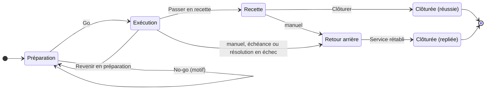

# Cycle de vie d'une MEP

Une MEP passe par cinq phases. Seuls le **pilote** et ses **suppléants** la font changer de phase ; un administrateur n'a pas ce droit s'il n'est pas lui-même pilote ou suppléant. Le détail de chaque droit est dans [Droits par rôle](Droits.md).

> [!IMPORTANT]
> Une fois le **point de non-retour** franchi, les flèches vers « Retour arrière » et « Préparation » disparaissent : on ne peut plus que corriger en avant, puis passer en recette.

## Préparation

L'équipe décrit l'intervention (voir [Préparer une MEP](Préparer-une-MEP.md)). Le bouton « Vérifier le plan » liste les **anomalies**, qui empêchent de démarrer, et les **avertissements**, qui ne l'empêchent pas.

Toute modification du contenu efface les approbations déjà données : les approbateurs doivent relire et se prononcer de nouveau.

## Go / no-go : passage en exécution

Le pilote ou un suppléant ouvre « Go / no-go ». Le Go n'est possible que si :

- le plan ne présente plus aucune anomalie, approbations comprises ;
- tous les critères go / no-go sont cochés (par exemple « Équipe présente et joignable », « Sauvegarde disponible ») ;
- la MEP n'est pas un modèle.

Les critères cochés sont enregistrés avec la MEP. Un **no-go** exige un motif : la MEP reste en préparation et le journal garde la trace de la décision. Le moment du Go devient la date de début de la MEP.

## Exécution

Les opérateurs déroulent le plan de déploiement (voir [Exécuter une MEP](Exécuter-une-MEP.md)). Pendant cette phase :

- un compte à rebours affiche le temps restant avant l'**échéance de retour arrière**, si la MEP en a une ;
- le pilote peut **revenir en préparation** tant qu'aucune étape ni résolution n'est en cours et que le point de non-retour n'est pas franchi ;
- le pilote passe **en recette** quand toutes les étapes de déploiement ont réussi.

## Point de non-retour

Une étape peut être marquée point de non-retour (par exemple une bascule de données irréversible). Pour la démarrer, il faut l'accord préalable du pilote ou d'un suppléant (« Autoriser le passage »). Dès qu'elle a démarré :

- le retour arrière n'est plus possible, ni manuel, ni automatique : on corrige en avant ;
- l'échéance ne s'applique plus ;
- on ne peut plus revenir en préparation.

## Recette

Les fiches de recette sont déroulées système par système : chaque étape de test est déclarée « Conforme » ou « Échec », avec une observation, dans l'application ou dans le classeur Excel de la recette réimporté par le pilote. Le pilote clôture la MEP comme **réussie** quand toutes les étapes de test sont conformes. Il peut faire refaire un test.

## Retour arrière

Le retour arrière arrête le plan de déploiement et ouvre le plan de retour arrière. Il se déclenche :

- **à la main**, par le pilote ou un suppléant, avec un motif, en exécution ou en recette ;
- **automatiquement**, quand l'échéance de retour arrière est atteinte, ou quand une correction ou la vérification finale d'une résolution guidée échoue.

Le déclenchement automatique est attribué à « Système » dans le journal. Aucun retour arrière n'est possible une fois le point de non-retour franchi, ni pour une MEP sans plan de retour arrière (case « Plan de retour arrière » décochée, voir [Préparer une MEP](Préparer-une-MEP.md#retour-arrière-facultatif)) : tout problème s'y corrige en avant. Sans échéance, seul le déclenchement automatique par l'échéance disparaît.

Quand toutes les étapes de retour arrière ont réussi, le pilote clôture avec « Service rétabli : clôturer » : la MEP est **repliée**.

## Clôture et bilan

À la clôture, si l'option « Bilan de clôture » est active (c'est le défaut), le pilote rédige un bilan : « Ce qui a marché » et « Incidents » sont obligatoires (« Rien à signaler » est accepté), « Actions » est facultatif. La MEP clôturée est en lecture seule ; le moment de la clôture devient sa date de fin.

## Modèles

Un modèle est une MEP qui sert de point de départ. On le crée directement (« Nouveau modèle » dans la vue Modèles) ou en dupliquant une MEP avec « En faire un modèle », et on l'utilise avec « Nouvelle MEP depuis un modèle » ou « Créer une MEP depuis ce modèle ». Un modèle ne passe jamais en exécution : il n'a ni phase, ni pilote, ni échéance, ni Go, ni onglet Exécution (ses onglets sont Préparation, Plan et Journal). Voir [Préparer une MEP](Préparer-une-MEP.md#partir-dune-mep-existante).
