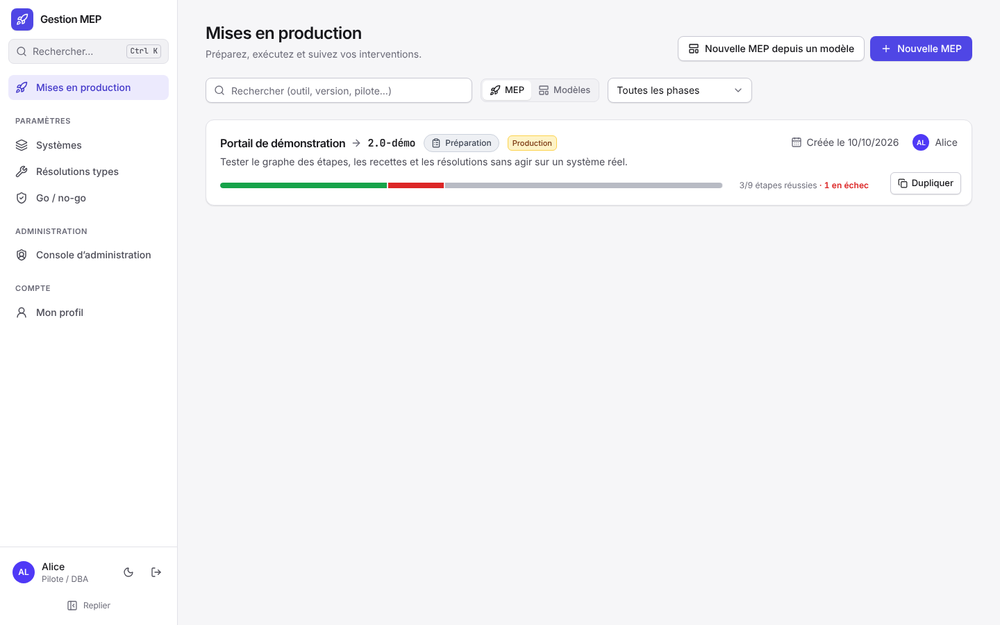

# Démarrage rapide

Lancer l'application sur un poste avec des données de démonstration, puis faire le tour d'une MEP. Pour une installation sur serveur, voir [Installer](Installer.md).

## Lancer

Prérequis : Docker Desktop (ou Docker Engine avec Docker Compose).

```bash
git clone https://github.com/SolaDevSolide/gestion-mep.git
cd gestion-mep
echo "DEMO=true" > .env
docker compose up --build
```

La première construction prend quelques minutes. Ouvrir ensuite http://localhost:8080.

> [!WARNING]
> `DEMO=true` crée des comptes au mot de passe connu. Ne jamais l'activer sur un serveur.

## Comptes de démonstration

Mot de passe `demo` pour tous.

| Compte | Rôle dans l'application | Rôle dans la MEP de démonstration |
|---|---|---|
| `alice` | Administratrice | Pilote |
| `bob` | Utilisateur | Suppléant du pilote, responsable technique API et MDM |
| `claire` | Utilisateur | Responsable technique WEB, approbatrice |

Pour être connecté avec plusieurs comptes en même temps, utiliser une fenêtre normale, une fenêtre de navigation privée et un autre navigateur. Les écrans se mettent à jour tout seuls : ce que fait l'un apparaît chez les autres sans recharger.

## Premier parcours

1. **Alice** : dans « Mises en production », ouvrir « Portail de démonstration ». La fiche s'ouvre sur l'onglet Préparation : ses sections, leur état de complétude et le bouton « Vérifier le plan », qui liste ce qui manque avant de pouvoir démarrer. Il reste l'approbation de Claire.

   
2. Parcourir l'onglet **Étapes** : le plan de déploiement en graphe, de haut en bas. Les étapes d'une même ligne peuvent se dérouler en parallèle ; l'étape encadrée de rouge est un point de non-retour. Cliquer une étape ouvre son espace d'édition (instructions, résultat attendu, liens, résolutions).

   
3. **Claire** : ouvrir la même MEP, Préparation, section « Validation », cliquer « Approuver ».
4. **Alice** : cliquer « Go / no-go », cocher les critères, puis « Go : passer en exécution ». La MEP passe en exécution et un compte à rebours indique le temps restant avant le retour arrière automatique.
5. Dans l'onglet **Exécution**, chacun démarre les étapes disponibles, saisit une preuve et déclare « Réussie » ou « Échec ». Une étape en échec propose les résolutions prévues pour la corriger.
6. Pour l'étape point de non-retour, Alice doit d'abord cliquer « Autoriser le passage ».
7. Quand toutes les étapes ont réussi : « Passer en recette », dérouler les fiches de l'onglet **Recette**, puis « Clôturer : MEP réussie » avec le bilan.
8. L'onglet **Journal** retrace toute l'intervention.

Pour essayer le retour arrière, dupliquer d'abord la MEP de démonstration (bouton « Dupliquer » de la liste) et dérouler la copie jusqu'à « Déclencher le retour arrière ».

## Repartir de zéro

```bash
docker compose down -v
docker compose up --build
```

Cette commande supprime toutes les données (MEP, pièces jointes, comptes) et recrée la démonstration.
