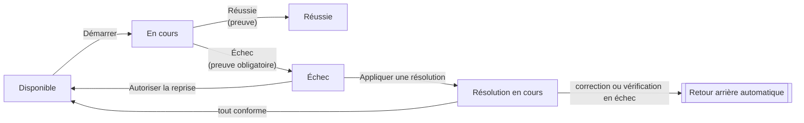
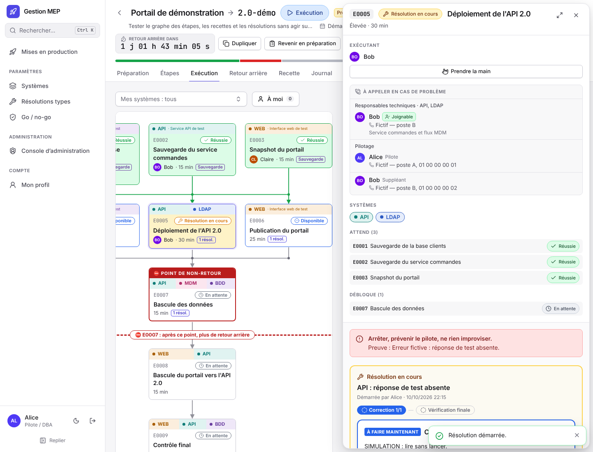
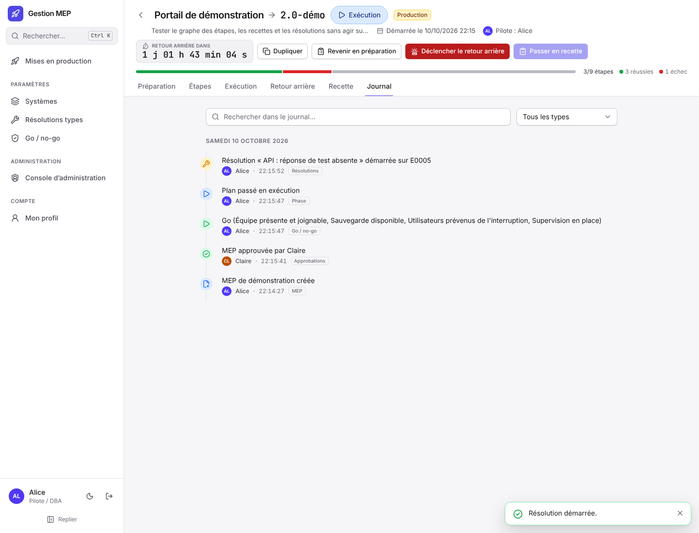

# Exécuter une MEP

Cette page s'adresse au **pilote**, à ses **suppléants** et aux **opérateurs** qui déroulent une MEP le jour J. Le pilote et les suppléants ont exactement les mêmes droits. Pour les phases et leurs conditions, voir [Cycle de vie](Cycle-de-vie.md).

## Avant de commencer

1. Vérifier que le plan est complet (« Vérifier le plan » : aucune anomalie) et que les approbations sont données.
2. Le pilote ou un suppléant ouvre « Go / no-go », coche les critères (équipe présente, sauvegarde disponible, utilisateurs prévenus…) et clique « Go : passer en exécution ». S'il manque quelque chose, « No-go » avec un motif laisse la MEP en préparation.

À partir du Go, l'en-tête affiche le compte à rebours « Retour arrière dans… », orange à moins d'une heure de l'échéance. À l'échéance, le retour arrière se déclenche automatiquement, sauf si le point de non-retour est franchi.

## L'onglet Exécution

Le plan s'affiche en graphe ; chaque étape indique son état :

| État | Sens |
|---|---|
| Disponible | Ses préalables sont réussis : on peut la démarrer. |
| Attend Exxxx | Une étape préalable n'est pas encore réussie. |
| En cours | Quelqu'un l'a démarrée. |
| Réussie / Terminée | Terminée avec succès. |
| Échec | Déclarée en échec : voir [Quand une étape échoue](#quand-une-étape-échoue). |
| Résolution en cours | Une résolution guidée est en train d'être appliquée. |

Filtres en haut du graphe :

- **Mes systèmes** : mettre en avant les étapes de certains systèmes ;
- **À moi** : les étapes que j'exécute.

Les étapes filtrées sont estompées, pas masquées. Les choix sont mémorisés pour chaque MEP.

## Dérouler une étape

1. Cliquer une étape disponible, lire les instructions. Les blocs de code ont un bouton « Copier ».
2. **Démarrer** : vous devenez l'exécutant de l'étape. Toute personne de la MEP reliée à un compte peut démarrer une étape disponible ; un administrateur aussi (il est alors ajouté à la MEP comme exécutant).
3. Réaliser l'intervention, puis renseigner la **preuve** (ce que vous avez constaté).
4. **Réussie** (avec la confirmation « J'ai vérifié et obtenu le résultat attendu ») ou **Échec** (preuve obligatoire).

Seuls l'exécutant, le pilote et les suppléants peuvent terminer une étape. Un commentaire peut être ajouté à tout moment. Les étapes suivantes deviennent disponibles dès que leurs préalables ont réussi : plusieurs personnes travaillent en parallèle.

## Prendre la main

Si l'exécutant d'une étape en cours ou en échec est injoignable, une autre personne de la MEP (ou un administrateur) peut **prendre la main**, avec un motif obligatoire. L'étape indique alors « Exécutée par X à la place de Y », et le journal garde le motif.

## Quand une étape échoue

L'étape en échec propose ses **résolutions prévues** (« Problème connu ? »). L'exécutant ou le pilote clique « Appliquer cette résolution » :

1. le diagnostic s'affiche, puis chaque correction dans l'ordre ;
2. pour chaque correction : l'appliquer, noter l'observation, déclarer « Conforme » ou « Échec » ;
3. après les corrections, la **vérification finale**.

Si tout est conforme, l'étape revient à faire et peut être redémarrée.

> [!CAUTION]
> Si une correction ou la vérification finale échoue, **le retour arrière se déclenche automatiquement** (sauf si le point de non-retour est franchi).

Sans résolution adaptée, le pilote ou un suppléant peut cliquer « Autoriser la reprise » pour que l'étape soit refaite, ou déclencher le retour arrière.

Une résolution utile qui manquait peut être créée depuis « Paramètres › Résolutions types » pour les prochaines fois.

## Point de non-retour

L'étape point de non-retour est encadrée de rouge. Avant qu'on puisse la démarrer, le pilote ou un suppléant doit cliquer **« Autoriser le passage »**.

> [!WARNING]
> Dès qu'elle démarre, le retour arrière n'est plus possible, ni manuel ni automatique : tout problème se corrige en avant. Un bandeau le rappelle à tous.

## Revenir en préparation

Tant que le point de non-retour n'est pas franchi et qu'aucune étape ni résolution n'est en cours, le pilote peut cliquer « Revenir en préparation » (par exemple pour corriger le plan). Les états des étapes sont conservés.

## Recette et clôture

1. Quand toutes les étapes de déploiement ont réussi, le pilote clique **« Passer en recette »**.
2. Dans l'onglet **Recette**, chaque étape de test est déclarée « Conforme » ou « Échec » avec une observation, par toute personne de la MEP reliée à un compte. Le pilote peut faire refaire un test ou une fiche.
3. Quand tout est conforme, le pilote clique **« Clôturer : MEP réussie »** et rédige le bilan.

Si la recette révèle un problème et que le point de non-retour n'est pas franchi, le pilote peut encore déclencher le retour arrière.

## Retour arrière

- **Déclencher le retour arrière** (pilote ou suppléant, motif obligatoire) arrête le déploiement. Un bandeau rouge l'indique à tous, avec son motif et son auteur (« Déclenchement automatique » s'il vient de l'échéance ou d'une résolution).
- L'onglet **Retour arrière** déroule son propre plan, étape par étape, comme l'exécution.
- Quand toutes ses étapes ont réussi, le pilote clique **« Service rétabli : clôturer »** et rédige le bilan. La MEP est clôturée comme repliée.

## Le journal

L'onglet **Journal** retrace tout, du plus récent au plus ancien, groupé par jour : qui a fait quoi et quand, motifs des prises de main, du no-go et du retour arrière, critères cochés au Go, résultats de recette. Une recherche et un filtre par type d'événement aident à s'y retrouver.

## Travailler à plusieurs

Les écrans se mettent à jour tout seuls pour tous les participants. Si une modification arrive pendant que vous saisissez quelque chose, un bandeau propose de recharger plutôt que d'écraser votre saisie. Si deux personnes modifient la même chose en même temps, la seconde est prévenue et la MEP est rechargée. Plusieurs personnes peuvent en revanche agir au même instant sur des étapes différentes (démarrer, terminer, commenter) : toutes les actions sont prises en compte, sans message ni rechargement.
