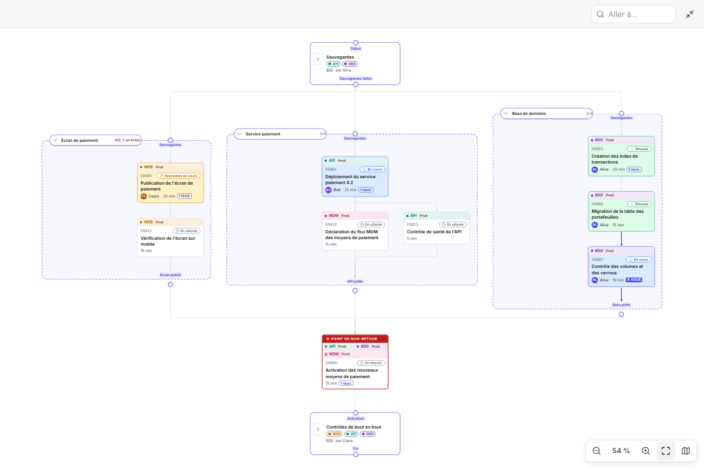
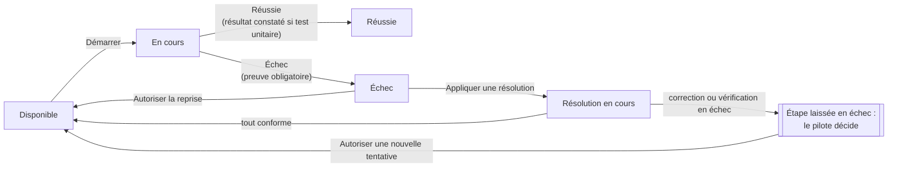
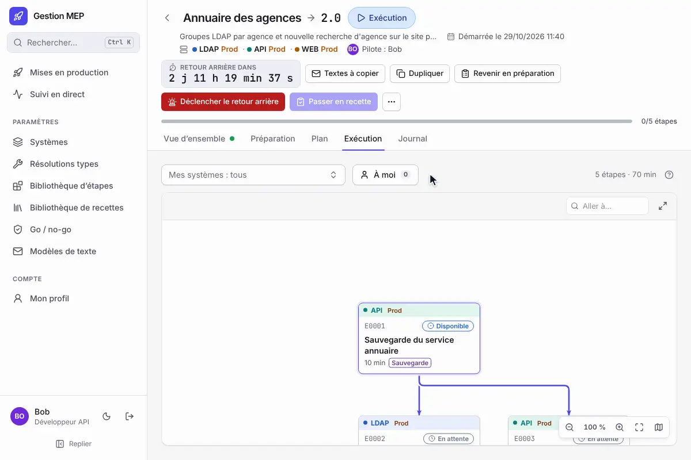
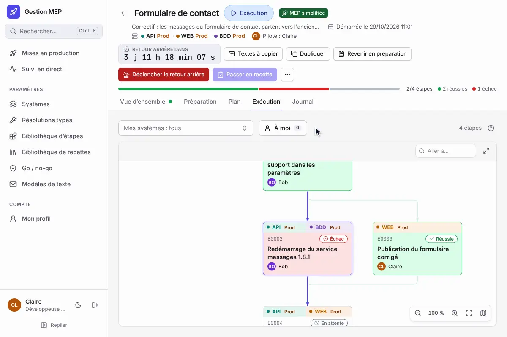
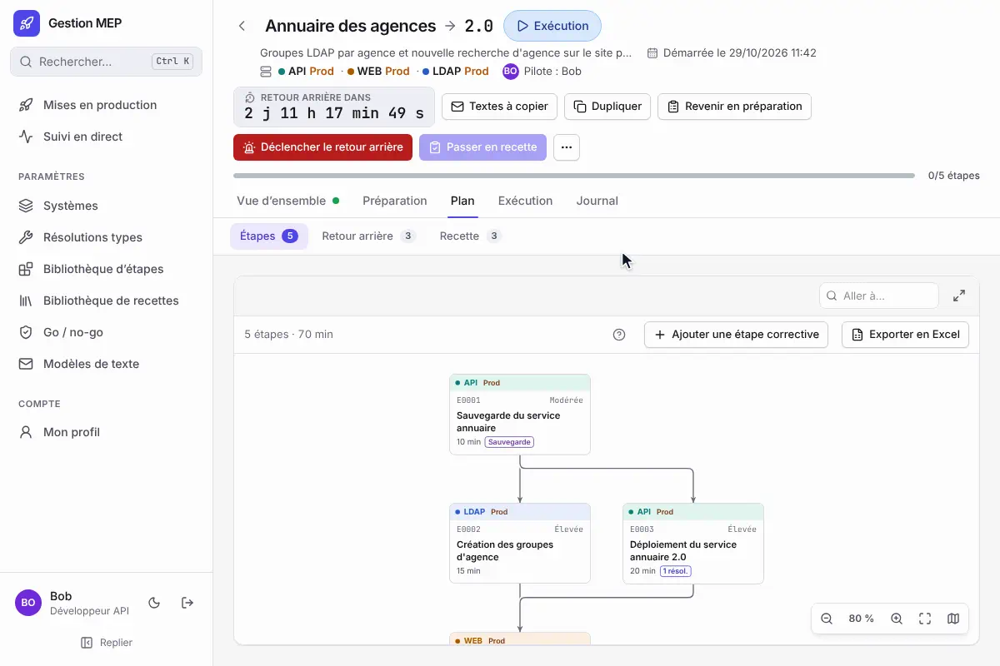
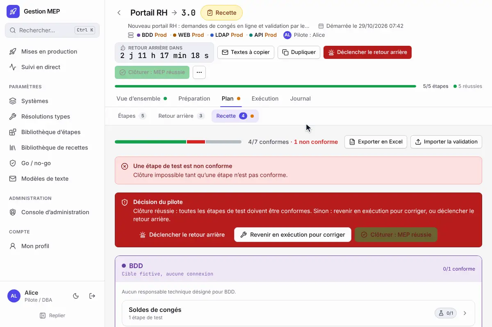
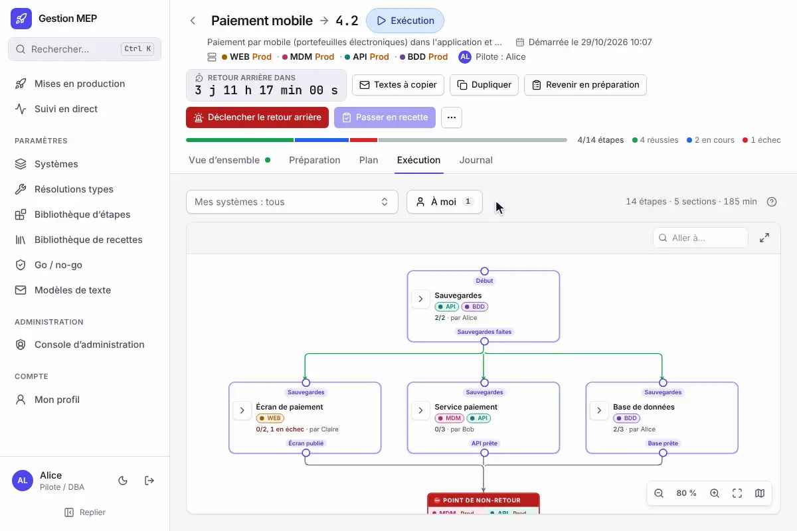
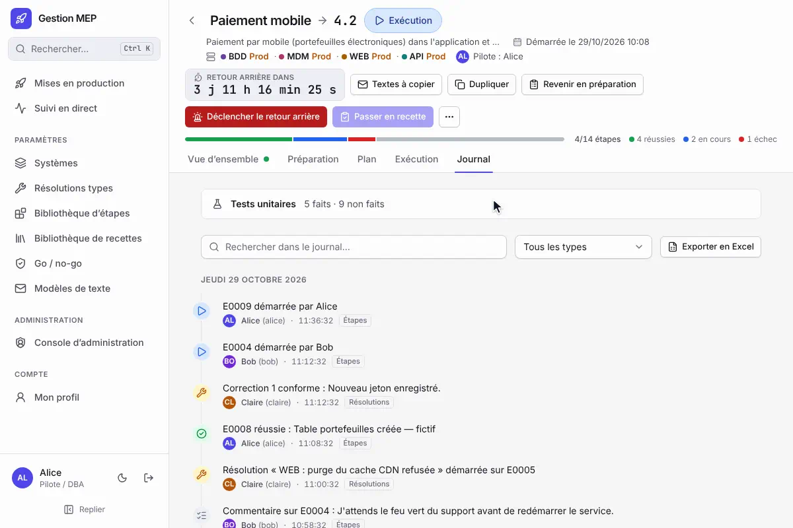

# Exécuter une MEP

Cette page s'adresse au **pilote**, à ses **suppléants** et aux **exécutants** qui déroulent une MEP le jour J. Le pilote et les suppléants ont exactement les mêmes droits. Pour les phases et leurs conditions, voir [Cycle de vie](Cycle-de-vie.md).

## Avant de commencer

1. Vérifier que le plan est complet (« Vérifier le plan » : aucune anomalie) et que les approbations sont données.
2. Le pilote ou un suppléant ouvre « Go / no-go », coche les critères (équipe présente, sauvegarde disponible, utilisateurs prévenus…) et clique « Go : passer en exécution ». S'il manque quelque chose, « No-go » avec un motif laisse la MEP en préparation ; la case « Reporter la MEP » la reporte en même temps, avec une date visée facultative (voir [Reporter une MEP](Cycle-de-vie.md#reporter-une-mep)).

À partir du Go, si la MEP a une échéance de retour arrière, l'en-tête affiche le compte à rebours « Retour arrière dans… », orange à moins d'une heure de l'échéance. L'heure de l'échéance est celle du fuseau horaire de la MEP. À l'échéance, pendant l'exécution, le retour arrière se déclenche automatiquement, sauf si le point de non-retour est franchi. Pendant la recette, il ne se déclenche **pas** : le compte à rebours affiche « ÉCHÉANCE DÉPASSÉE », un bandeau le signale dans Plan › Recette et le pilote décide (voir [Recette et clôture](#recette-et-clôture)). Le pilote ou un suppléant peut reporter l'échéance avec « Modifier l'échéance » (section Intervention ou bandeau de la recette) : motif obligatoire, ancienne et nouvelle valeur au journal. Une MEP sans échéance n'a ni compte à rebours ni déclenchement automatique ; une MEP sans plan de retour arrière n'a ni sous-onglet Plan › Retour arrière, ni bouton « Déclencher le retour arrière » (voir [Préparer une MEP](Préparer-une-MEP.md#retour-arrière-facultatif)).

À toutes les phases, le bouton **Textes à copier** de l'en-tête ouvre les modèles de texte de l'équipe remplis avec les informations de la MEP (rappel le jour J, compte rendu de fin…) : voir [Modèles de texte](Modèles-de-texte.md).

## L'onglet Exécution

Le plan s'affiche en graphe, dans un cadre qui tient dans la hauteur de la fenêtre (le bouton en haut à droite l'affiche en plein écran, Échap pour revenir) ; une section s'affiche repliée avec son avancement (« 4/7, 1 en échec ») et se déplie d'un clic. Ouvrir une étape met ses liens en avant ; survoler ou cliquer un lien le met en avant avec ses deux bouts (là où plusieurs liens partagent un tronçon, un clic demande lequel). Chaque étape indique son état :

| État | Sens |
|---|---|
| Disponible | Ses préalables sont réussis : on peut la démarrer. |
| Attend Exxxx | Une étape préalable n'est pas encore réussie. |
| En cours | Quelqu'un l'a démarrée. |
| Réussie | Terminée avec succès. |
| Échec | Déclarée en échec : voir [Quand une étape échoue](#quand-une-étape-échoue). |
| Résolution en cours | Une résolution guidée est en train d'être appliquée. |

Filtres en haut du graphe :

- **Mes systèmes** : mettre en avant les étapes de certains systèmes ;
- **À moi** : les étapes que j'exécute.

Les étapes filtrées sont estompées, pas masquées. Les choix sont mémorisés pour chaque MEP.

## Dérouler une étape

1. Cliquer une étape disponible, lire les instructions. Les blocs de code ont un bouton « Copier ».
2. **Démarrer** : vous devenez l'exécutant de l'étape. Toute personne de la MEP reliée à un compte peut démarrer une étape disponible ; un administrateur aussi (il est alors ajouté à la MEP comme exécutant).
3. Réaliser l'intervention, puis renseigner la **preuve** (ce que vous avez constaté : sortie de commande, capture décrite…).
4. **Réussie** (avec la confirmation « J'ai vérifié et obtenu le résultat attendu ») ou **Échec** (preuve obligatoire). Pour une étape qui se termine par un **test unitaire** (le cas par défaut), la confirmation « Réussie » demande aussi le **résultat constaté** ; une **simple vérification** n'en demande pas. En cas d'échec d'un test unitaire, la preuve tient lieu de résultat constaté.

*Démarrer, preuve, « Réussie » puis le résultat constaté : E0002 et E0003, qui attendaient E0001, deviennent disponibles.*

Seuls l'exécutant, le pilote et les suppléants peuvent terminer une étape. Un commentaire peut être ajouté à tout moment. Les étapes suivantes deviennent disponibles dès que leurs préalables ont réussi : plusieurs personnes travaillent en parallèle.

## Prendre la main

Si l'exécutant d'une étape en cours ou en échec est injoignable, une autre personne de la MEP (ou un administrateur) peut **prendre la main**, avec un motif obligatoire. L'étape indique alors « Exécutée par X à la place de Y », et le journal garde le motif.

*Le motif est obligatoire ; l'étape passe à Alice et le journal garde le motif.*

## Quand une étape échoue

L'étape en échec propose ses **résolutions prévues** (« Problème connu ? »). Dans une [MEP simplifiée](Préparer-une-MEP.md#mep-complète-ou-simplifiée), qui n'a pas de résolutions liées, ce sont **toutes les résolutions types actives des systèmes de l'étape**, regroupées par système, puis sous « Tous les systèmes » celles qui ne visent aucun système. L'exécutant ou le pilote (ou, dans une MEP simplifiée, n'importe quelle personne de la MEP, toutes étant suppléantes) clique « Appliquer cette résolution » :

1. le diagnostic s'affiche, puis chaque correction dans l'ordre ;
2. pour chaque correction : l'appliquer, noter l'observation, déclarer « Conforme » ou « Échec » ;
3. après les corrections, la **vérification finale**.

*Chaque correction se déclare « Conforme » ou « Échec » avec ce qu'on constate ; tout conforme, l'étape peut être redémarrée.*

La résolution appliquée est la copie **figée dans la MEP** à l'approbation (ou au Go) : titre, contenu et version approuvés, même si la fiche a changé depuis dans la bibliothèque. Le journal indique la version appliquée.

Si tout est conforme, l'étape revient à faire et peut être redémarrée.

> [!IMPORTANT]
> Si une correction ou la vérification finale échoue, la résolution s'arrête et **l'étape reste en échec** : rien ne se déclenche automatiquement. Le journal le note et l'étape affiche « Résolution en échec : le pilote décide ». Le pilote ou un suppléant choisit **« Déclencher le retour arrière »** (motif obligatoire ; si la MEP a un plan de retour arrière et que le point de non-retour n'est pas franchi) ou **« Autoriser une nouvelle tentative »** de l'étape. Les autres personnes de la MEP préviennent le pilote.

Sans résolution adaptée, le pilote ou un suppléant peut cliquer « Autoriser la reprise » pour que l'étape soit refaite, ou déclencher le retour arrière.

Une résolution utile qui manquait peut être créée depuis « Paramètres › Résolutions types » pour les prochaines fois.

## Point de non-retour

L'étape point de non-retour est encadrée de rouge. Avant qu'on puisse la démarrer, le pilote ou un suppléant doit cliquer **« Autoriser le passage »**.

*Une fois le passage autorisé, l'encadré le rappelle avec son auteur et l'heure.*

> [!WARNING]
> Dès qu'elle démarre, le retour arrière n'est plus possible, ni manuel ni automatique : tout problème se corrige en avant. Un bandeau le rappelle à tous.

## Revenir en préparation

Tant que le point de non-retour n'est pas franchi et qu'aucune étape ni résolution n'est en cours, le pilote peut cliquer « Revenir en préparation » (par exemple pour corriger le plan), avec un **motif obligatoire**, inscrit au journal. Les états des étapes sont conservés, comme l'heure du premier Go. Une fois revenue en préparation, la MEP peut être corrigée puis relancée par un nouveau Go, ou [annulée](Cycle-de-vie.md#annuler-une-mep) depuis le menu « ⋯ Plus d'actions » (motif et état laissé en production obligatoires).

*Le motif est inscrit au journal ; la MEP rouvre sur sa préparation.*

## Ajouter une étape corrective

Pendant l'exécution, le pilote ou un suppléant clique **« Ajouter une étape corrective »** dans **Plan › Étapes** pour corriger en avant : action, système, instructions et résultat attendu sont obligatoires, comme la durée et la criticité dans une MEP complète. L'étape prend le code suivant (`E0006`, `E0007`…), attend les dernières étapes du plan, et porte la mention **« Ajoutée après le Go »** dans le graphe, la fiche de l'étape et le rapport de fin. Sa fiche ne se modifie plus ensuite : si elle ne convient pas, on en ajoute une autre.

*L'étape s'ajoute à la fin du plan et porte la mention « Ajoutée après le Go ».*

## Recette et clôture

1. Quand toutes les étapes de déploiement ont réussi, le pilote clique **« Passer en recette »**.
2. Dans **Plan › Recette** (la MEP s'y ouvre pendant la recette), ouvrir chaque fiche : chaque étape de test est déclarée « Conforme » ou « Non conforme » avec une observation, par toute personne de la MEP reliée à un compte. Le pilote peut faire refaire un test ou une fiche. Les équipes métier peuvent aussi valider dans Excel (voir ci-dessous).

   

   *L'observation est obligatoire ; le retour à la recette montre l'avancement mis à jour.*

3. Quand tout est conforme, le pilote clique **« Clôturer : MEP réussie »** et rédige le bilan. Le [rapport de fin](Suivre-une-MEP.md#rapport-de-fin) est alors figé (bouton « Rapport de fin » du bilan). Si une étape ou un test de recette a échoué en route, même repris ensuite, la MEP s'affiche « Clôturée : réussie avec incidents » (voir [Cycle de vie](Cycle-de-vie.md#clôture-et-bilan)).

### Valider la recette dans Excel

**« Exporter en Excel »**, en haut de **Plan › Recette**, télécharge un classeur à envoyer aux équipes métier : l'onglet « À lire » (mode d'emploi, légende, exemple de saisie), un sommaire avec l'avancement de chaque fiche (étapes conformes, non conformes, restantes, recalculées par Excel à chaque saisie) et un lien vers elle, puis un onglet par système : un tableau avec une ligne par étape de test (fiche, numéro, déroulé avec le code en police à chasse fixe, résultat attendu), qu'on peut trier et filtrer. Seules les cases jaunes se remplissent : résultat constaté, validation (liste « Conforme » / « Non conforme »), validé par (liste des personnes de la MEP, autre nom accepté) et date ; une note sur chaque en-tête rappelle quoi saisir, et le reste est protégé. Des feuilles masquées identifient la MEP, la version de la recette exportée et chaque ligne (colonne « Réf. » masquée).

Une fois le fichier rempli, le pilote ou un suppléant clique **« Importer la validation »** (en phase de recette). L'application affiche d'abord ce qui va changer, étape par étape, puis l'applique sur confirmation : « Conforme » rend l'étape conforme, « Non conforme » la met en échec, avec le résultat constaté comme observation, la personne et la date indiquées dans le fichier. Les lignes sans validation sont ignorées. Trier, filtrer, réordonner les lignes ou les colonnes ne gêne pas l'import (chaque ligne est retrouvée par sa référence, chaque colonne par son en-tête) ; la casse, les accents et les espaces autour sont ignorés (« non-conforme » est accepté), et « Validé » / « Refusé », libellés des fichiers exportés avant, restent acceptés. Un fichier exporté par la version précédente de l'application est toujours accepté. Chaque motif de refus indique l'onglet, la ligne, l'étape et la colonne en cause.

Le fichier est **refusé en entier**, sans rien modifier, avec la liste des motifs, s'il est incohérent : fichier d'une autre MEP, recette modifiée depuis l'export (exporter à nouveau), colonne d'en-tête supprimée, référence d'étape modifiée ou inconnue, valeur de validation inconnue, « Validé par » manquant, date illisible, « Non conforme » sans résultat constaté, ou validation qui contredit un résultat déjà saisi dans l'application (faire d'abord refaire l'étape). Un import n'efface jamais un résultat : pour refaire une étape, le pilote utilise « Refaire ». L'import est inscrit dans le journal de la MEP.

Si la recette révèle un problème, le cadre **« Décision du pilote »** de **Plan › Recette** propose :

- **« Revenir en exécution pour corriger »** (motif obligatoire) : la MEP repasse en exécution, on y ajoute des [étapes correctives](#ajouter-une-étape-corrective), puis on repasse en recette. Les tests en échec redeviennent « à faire ». Impossible une fois l'échéance de retour arrière dépassée : la reporter d'abord ;
- **« Déclencher le retour arrière »**, si la MEP a un plan de retour arrière et que le point de non-retour n'est pas franchi ;
- **« Clôturer en échec… »**, seulement quand le retour arrière est impossible et que le service ne peut pas être rétabli (voir ci-dessous).

Si l'**échéance de retour arrière** est atteinte pendant la recette, le retour arrière **ne se déclenche pas** : le bandeau « Échéance de retour arrière dépassée » le signale (avec « Modifier l'échéance ») et le journal le note une fois. Le pilote décide : retour arrière **manuel**, ou report de l'échéance avec un motif.

## Retour arrière

- **Déclencher le retour arrière** (pilote ou suppléant, motif obligatoire) arrête le déploiement. Un bandeau rouge l'indique à tous, avec son motif et son auteur (« Déclenchement automatique » s'il vient de l'échéance, en exécution).

  

  *La MEP s'ouvre sur Plan › Retour arrière, sous le bandeau rouge qui rappelle le motif et son auteur.*

- **Plan › Retour arrière** (la MEP s'y ouvre pendant un retour arrière) déroule son propre plan, étape par étape, comme l'exécution.
- Quand toutes ses étapes ont réussi, le pilote clique **« Service rétabli : clôturer »** et rédige le bilan. La MEP est clôturée après retour arrière.
- Si une étape du retour arrière échoue et que le service ne peut pas être rétabli, l'encadré **« Retour arrière en échec »** propose de suivre la consigne « Si le retour arrière échoue » du plan, puis **« Clôturer en échec… »**.

## Clôturer en échec

« Clôturer en échec… » (pilote ou suppléant) demande l'**état du service laissé en production** (obligatoire, par exemple « Consultation en lecture seule, dépôt des courriers indisponible »), la **référence de l'incident** (facultative) et le **bilan** (« Ce qui a marché » et « Incidents » obligatoires, même si le bilan est désactivé). Aucune étape ne doit être en cours. La MEP est clôturée **« Clôturée : échec »**, en rouge ; le bilan et le rapport de fin rappellent l'état du service et l'incident.

## Changer de pilote pendant la MEP

Après le Go, le pilote ou un suppléant **passe le pilotage** depuis le menu « ⋯ Plus d'actions » (« Passer le pilotage… ») : choisir une personne de la MEP reliée à un compte, ou un compte qui n'y figure pas encore, et indiquer le motif. L'ancien pilote reste suppléant par défaut. Si ni le pilote ni les suppléants ne répondent, un administrateur peut prendre le **pilotage de secours** (voir [Cycle de vie](Cycle-de-vie.md#pilotage-de-secours-et-passation)) : un bandeau le signale à tous jusqu'à la clôture.

*Bob devient pilote ; Alice reste suppléante.*

Une personne (astreinte, renfort) s'ajoute aussi après le Go, par le pilote, un suppléant ou un administrateur, dans **Préparation › Personnes**.

## Le journal

L'onglet **Journal** retrace tout, du plus récent au plus ancien, groupé par jour : qui a fait quoi et quand, motifs des prises de main, du no-go, du report, des retours en préparation ou en exécution, de l'annulation, des changements de pilote et du retour arrière, critères cochés au Go, résultats constatés des tests unitaires, résultats de recette. Une recherche et un filtre par type d'événement aident à s'y retrouver ; ils portent sur tout le journal. Les 100 derniers événements s'affichent d'abord, « Afficher plus » en bas ajoute les précédents ; les nouveaux arrivent en haut au fil des actions, sans recharger le reste. **« Exporter en Excel »**, au bout de cette ligne, télécharge les événements affichés (filtres compris) et le suivi des tests unitaires ; les vues du plan s'exportent de la même façon (voir [Exporter en Excel](Préparer-une-MEP.md#exporter-en-excel)).

En tête du journal, l'encadré **Tests unitaires** compte les tests faits et non faits (et les simples vérifications) ; déplié, il donne pour chaque test le résultat attendu, le résultat constaté, l'exécutant et l'état (réussi, échec, non fait). Les étapes du retour arrière n'y figurent qu'une fois celui-ci déclenché. Une étape reprise après un échec redevient « non faite » jusqu'à sa nouvelle fin.

*La recherche et le filtre portent sur tout le journal ; l'encadré Tests unitaires détaille chaque test.*

## Suivre sans exécuter

Qui n'exécute aucune étape (chef de projet, astreinte) arrive sur la **vue d'ensemble** de la MEP : chiffres clés, fin estimée, plan coloré, blocages et qui fait quoi. Le tableau de bord **Suivi en direct** montre toutes les MEP lancées, et chaque MEP clôturée a son **rapport de fin**. Voir [Suivre une MEP](Suivre-une-MEP.md).

## Travailler à plusieurs

Les écrans se mettent à jour tout seuls pour tous les participants, sans recharger. En haut de la MEP, « Sur cette MEP : » montre qui d'autre l'a ouverte ; l'élément qu'une personne modifie est encadré de sa couleur avec l'étiquette « Prénom modifie » (voir [Préparer à plusieurs](Préparer-une-MEP.md#préparer-à-plusieurs)). Une saisie en cours n'est jamais écrasée : si sa section change entre-temps, un avertissement laisse choisir entre la version à jour et votre saisie. Si deux personnes modifient la même chose en même temps, la seconde est prévenue, la MEP est mise à jour et sa saisie conservée. Quitter une vue avec des modifications non enregistrées demande confirmation (« Quitter sans enregistrer ? »). Plusieurs personnes peuvent en revanche agir au même instant sur des étapes différentes (démarrer, terminer, commenter) : toutes les actions sont prises en compte, sans message ni rechargement.
