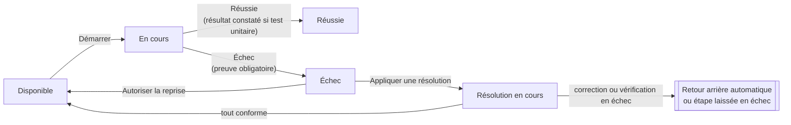

# Exécuter une MEP

Cette page s'adresse au **pilote**, à ses **suppléants** et aux **opérateurs** qui déroulent une MEP le jour J. Le pilote et les suppléants ont exactement les mêmes droits. Pour les phases et leurs conditions, voir [Cycle de vie](Cycle-de-vie.md).

## Avant de commencer

1. Vérifier que le plan est complet (« Vérifier le plan » : aucune anomalie) et que les approbations sont données.
2. Le pilote ou un suppléant ouvre « Go / no-go », coche les critères (équipe présente, sauvegarde disponible, utilisateurs prévenus…) et clique « Go : passer en exécution ». S'il manque quelque chose, « No-go » avec un motif laisse la MEP en préparation.

À partir du Go, si la MEP a une échéance de retour arrière, l'en-tête affiche le compte à rebours « Retour arrière dans… », orange à moins d'une heure de l'échéance. À l'échéance, le retour arrière se déclenche automatiquement, sauf si le point de non-retour est franchi. Une MEP sans échéance n'a ni compte à rebours ni déclenchement automatique ; une MEP sans plan de retour arrière n'a ni sous-onglet Plan › Retour arrière, ni bouton « Déclencher le retour arrière » (voir [Préparer une MEP](Préparer-une-MEP.md#retour-arrière-facultatif)).

À toutes les phases, le bouton **Textes à copier** de l'en-tête ouvre les modèles de texte de l'équipe remplis avec les informations de la MEP (rappel le jour J, compte rendu de fin…) : voir [Modèles de texte](Modèles-de-texte.md).

## L'onglet Exécution

Le plan s'affiche en graphe, dans un cadre qui tient dans la hauteur de la fenêtre (le bouton en haut à droite l'affiche en plein écran, Échap pour revenir) ; une section s'affiche repliée avec son avancement (« 4/7, 1 en échec ») et se déplie d'un clic. Ouvrir une étape met ses liens en avant ; survoler ou cliquer un lien le met en avant avec ses deux bouts (là où plusieurs liens partagent un tronçon, un clic demande lequel). Chaque étape indique son état :

| État | Sens |
|---|---|
| Disponible | Ses préalables sont réussis : on peut la démarrer. |
| Attend Exxxx | Une étape préalable n'est pas encore réussie. |
| En cours | Quelqu'un l'a démarrée. |
| Réussie / Terminée | Terminée avec succès. |
| Échec | Déclarée en échec : voir [Quand une étape échoue](#quand-une-étape-échoue). |
| Résolution en cours | Une résolution guidée est en train d'être appliquée. |

Filtres en haut du graphe :

- **Mes systèmes** : mettre en avant les étapes de certains systèmes ;
- **À moi** : les étapes que j'exécute.

Les étapes filtrées sont estompées, pas masquées. Les choix sont mémorisés pour chaque MEP.

## Dérouler une étape

1. Cliquer une étape disponible, lire les instructions. Les blocs de code ont un bouton « Copier ».
2. **Démarrer** : vous devenez l'exécutant de l'étape. Toute personne de la MEP reliée à un compte peut démarrer une étape disponible ; un administrateur aussi (il est alors ajouté à la MEP comme exécutant).
3. Réaliser l'intervention, puis renseigner la **preuve** (ce que vous avez constaté : sortie de commande, capture décrite…).
4. **Réussie** (avec la confirmation « J'ai vérifié et obtenu le résultat attendu ») ou **Échec** (preuve obligatoire). Pour une étape qui se termine par un **test unitaire** (le cas par défaut), la confirmation « Réussie » demande aussi le **résultat constaté** ; une **simple vérification** n'en demande pas. En cas d'échec d'un test unitaire, la preuve tient lieu de résultat constaté.

Seuls l'exécutant, le pilote et les suppléants peuvent terminer une étape. Un commentaire peut être ajouté à tout moment. Les étapes suivantes deviennent disponibles dès que leurs préalables ont réussi : plusieurs personnes travaillent en parallèle.

## Prendre la main

Si l'exécutant d'une étape en cours ou en échec est injoignable, une autre personne de la MEP (ou un administrateur) peut **prendre la main**, avec un motif obligatoire. L'étape indique alors « Exécutée par X à la place de Y », et le journal garde le motif.

## Quand une étape échoue

L'étape en échec propose ses **résolutions prévues** (« Problème connu ? »). Dans une [MEP simplifiée](Préparer-une-MEP.md#mep-complète-ou-simplifiée), qui n'a pas de résolutions liées, ce sont **toutes les résolutions types actives des systèmes de l'étape**, regroupées par système, puis sous « Tous les systèmes » celles qui ne visent aucun système. L'exécutant ou le pilote (ou, dans une MEP simplifiée, n'importe quelle personne de la MEP, toutes étant suppléantes) clique « Appliquer cette résolution » :

1. le diagnostic s'affiche, puis chaque correction dans l'ordre ;
2. pour chaque correction : l'appliquer, noter l'observation, déclarer « Conforme » ou « Échec » ;
3. après les corrections, la **vérification finale**.

Si tout est conforme, l'étape revient à faire et peut être redémarrée.

> [!CAUTION]
> Si une correction ou la vérification finale échoue, **le retour arrière se déclenche automatiquement** (sauf si le point de non-retour est franchi).

Sans résolution adaptée, le pilote ou un suppléant peut cliquer « Autoriser la reprise » pour que l'étape soit refaite, ou déclencher le retour arrière.

Une résolution utile qui manquait peut être créée depuis « Paramètres › Résolutions types » pour les prochaines fois.

## Point de non-retour

L'étape point de non-retour est encadrée de rouge. Avant qu'on puisse la démarrer, le pilote ou un suppléant doit cliquer **« Autoriser le passage »**.

> [!WARNING]
> Dès qu'elle démarre, le retour arrière n'est plus possible, ni manuel ni automatique : tout problème se corrige en avant. Un bandeau le rappelle à tous.

## Revenir en préparation

Tant que le point de non-retour n'est pas franchi et qu'aucune étape ni résolution n'est en cours, le pilote peut cliquer « Revenir en préparation » (par exemple pour corriger le plan). Les états des étapes sont conservés.

## Recette et clôture

1. Quand toutes les étapes de déploiement ont réussi, le pilote clique **« Passer en recette »**.
2. Dans **Plan › Recette** (la MEP s'y ouvre pendant la recette), ouvrir chaque fiche : chaque étape de test est déclarée « Conforme » ou « Échec » avec une observation, par toute personne de la MEP reliée à un compte. Le pilote peut faire refaire un test ou une fiche. Les équipes métier peuvent aussi valider dans Excel (voir ci-dessous).
3. Quand tout est conforme, le pilote clique **« Clôturer : MEP réussie »** et rédige le bilan.

### Valider la recette dans Excel

**« Exporter en Excel »**, en haut de **Plan › Recette**, télécharge un classeur à envoyer aux équipes métier : un sommaire avec le mode d'emploi et l'avancement de chaque fiche, puis un onglet par système avec ses fiches à la suite (déroulé, code en police à chasse fixe sur fond gris, résultat attendu). Seules les cases jaunes se remplissent : résultat constaté, validation (liste « Validé » / « Refusé »), validé par et date ; le reste est protégé. Une feuille masquée « Contrôle » identifie la MEP et la version de la recette exportée.

Une fois le fichier rempli, le pilote ou un suppléant clique **« Importer la validation »** (en phase de recette). L'application affiche d'abord ce qui va changer, étape par étape, puis l'applique sur confirmation : « Validé » rend l'étape conforme, « Refusé » la met en échec, avec le résultat constaté comme observation, la personne et la date indiquées dans le fichier. Les lignes sans validation sont ignorées.

Le fichier est **refusé en entier**, sans rien modifier, avec la liste des motifs, s'il est incohérent : fichier d'une autre MEP, recette modifiée depuis l'export (exporter à nouveau), onglet renommé ou supprimé, étape déplacée ou inconnue, valeur de validation inconnue, « Validé par » manquant, date illisible, « Refusé » sans résultat constaté, ou validation qui contredit un résultat déjà saisi dans l'application (faire d'abord refaire l'étape). Un import n'efface jamais un résultat : pour refaire une étape, le pilote utilise « Refaire ». L'import est inscrit dans le journal de la MEP.

Si la recette révèle un problème, que la MEP a un plan de retour arrière et que le point de non-retour n'est pas franchi, le pilote peut encore déclencher le retour arrière.

## Retour arrière

- **Déclencher le retour arrière** (pilote ou suppléant, motif obligatoire) arrête le déploiement. Un bandeau rouge l'indique à tous, avec son motif et son auteur (« Déclenchement automatique » s'il vient de l'échéance ou d'une résolution).
- **Plan › Retour arrière** (la MEP s'y ouvre pendant un retour arrière) déroule son propre plan, étape par étape, comme l'exécution.
- Quand toutes ses étapes ont réussi, le pilote clique **« Service rétabli : clôturer »** et rédige le bilan. La MEP est clôturée comme repliée.

## Le journal

L'onglet **Journal** retrace tout, du plus récent au plus ancien, groupé par jour : qui a fait quoi et quand, motifs des prises de main, du no-go et du retour arrière, critères cochés au Go, résultats constatés des tests unitaires, résultats de recette. Une recherche et un filtre par type d'événement aident à s'y retrouver. **« Exporter en Excel »**, au bout de cette ligne, télécharge les événements affichés (filtres compris) et le suivi des tests unitaires ; les vues du plan s'exportent de la même façon (voir [Exporter en Excel](Préparer-une-MEP.md#exporter-en-excel)).

En tête du journal, l'encadré **Tests unitaires** compte les tests faits et non faits (et les simples vérifications) ; déplié, il donne pour chaque test le résultat attendu, le résultat constaté, l'exécutant et l'état (réussi, échec, non fait). Les étapes du retour arrière n'y figurent qu'une fois celui-ci déclenché. Une étape reprise après un échec redevient « non faite » jusqu'à sa nouvelle fin.

## Travailler à plusieurs

Les écrans se mettent à jour tout seuls pour tous les participants, sans recharger. En haut de la MEP, « Sur cette MEP : » montre qui d'autre l'a ouverte ; l'élément qu'une personne modifie est encadré de sa couleur avec l'étiquette « Prénom modifie » (voir [Préparer à plusieurs](Préparer-une-MEP.md#préparer-à-plusieurs)). Une saisie en cours n'est jamais écrasée : si sa section change entre-temps, un avertissement laisse choisir entre la version à jour et votre saisie. Si deux personnes modifient la même chose en même temps, la seconde est prévenue, la MEP est mise à jour et sa saisie conservée. Quitter une vue avec des modifications non enregistrées demande confirmation (« Quitter sans enregistrer ? »). Plusieurs personnes peuvent en revanche agir au même instant sur des étapes différentes (démarrer, terminer, commenter) : toutes les actions sont prises en compte, sans message ni rechargement.
