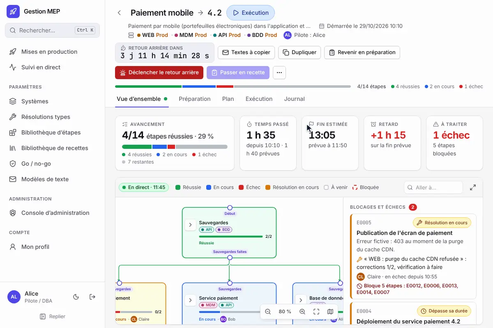
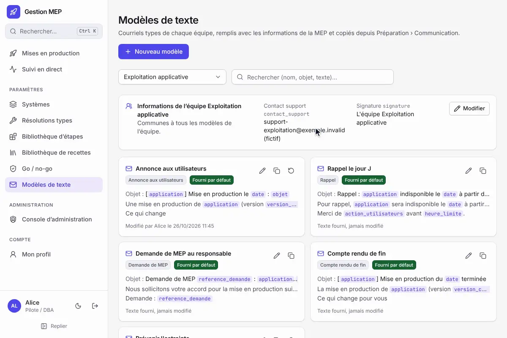

# Modèles de texte

Les équipes envoient des courriels à chaque MEP : annonce aux utilisateurs, rappel le jour J, demande de MEP au responsable, compte rendu de fin. L'application n'envoie rien : elle remplit des **modèles de texte** avec les informations de la MEP, et on copie le résultat dans sa messagerie en un clic.

## Où les trouver

- **Dans une MEP** : Préparation › section 8 « Communication », carte « Textes à copier », ou le bouton **Textes à copier** de l'en-tête, à toutes les phases (le rappel et le compte rendu servent pendant et après l'exécution).
- **Paramètres › Modèles de texte** : les modèles de chaque équipe, à créer, modifier, dupliquer ou supprimer.

Les mêmes variables remplissent aussi les messages des [connexions aux API externes](API-externes.md), qui les envoient automatiquement à un autre outil (Teams, Slack, outil de tickets…), avec en plus les variables du groupe [Événement](#événement).

On choisit l'équipe dont on prend les modèles. Par défaut, c'est l'équipe du pilote (s'il en a plusieurs, la première par ordre alphabétique) ; à défaut, une équipe de la personne connectée, puis la première équipe.

## Copier un texte

1. Choisir un modèle dans la liste : l'objet et le texte se remplissent avec les informations de la MEP.
2. Choisir **Mis en forme** (gras et listes, pour une messagerie qui les accepte) ou **Texte simple** (puces « - », sans gras). Le choix change à la fois l'aperçu et ce qui est copié.
3. **Copier l'objet**, puis **Copier le texte**.

*Le texte se remplit avec les informations de « Paiement mobile » ; rien n'est envoyé, tout est copié.*

Une information absente de la MEP est signalée dans un encadré orange et apparaît dans le texte sous la forme « [Indisponibilité prévue à compléter] », pour qu'on la repère avant d'envoyer.

## Modèles fournis

Chaque équipe reçoit une copie de quatre modèles fournis, à sa création (les équipes créées avant cette fonctionnalité les reçoivent au démarrage suivant) :

| Modèle | Usage |
|---|---|
| Annonce aux utilisateurs | Date, ce qui change, interruption de service, action attendue |
| Rappel le jour J | Indisponibilité et action attendue avant l'heure limite |
| Demande de MEP au responsable | Référence de la demande, systèmes, environnements, objets impactés, niveau de risque, validation par les utilisateurs |
| Compte rendu de fin | Issue, ce qui change, bilan |

Ils portent le badge « Fourni par défaut ». Ils se modifient et se dupliquent mais ne se suppriment pas ; **Rétablir le texte fourni** remet leur nom, leur usage, leur objet et leur texte d'origine. Les modèles créés par l'équipe se suppriment.

## Qui modifie quoi

Tout le monde consulte les modèles et copie les textes. Les **membres de l'équipe** (par l'un de leurs comptes reliés) et les administrateurs créent, modifient, rétablissent et suppriment ses modèles, et règlent les informations communes de l'équipe : **contact support** et **signature** (vide : « L'équipe {nom} »). Chaque changement est inscrit au journal d'administration. L'équipe d'un modèle ne change pas : on le duplique dans l'autre équipe.

## Écrire un modèle

| Syntaxe | Effet |
|---|---|
| `{{variable}}` | Remplacée par l'information de la MEP (liste ci-dessous) |
| `**texte**` | Gras |
| `- ` en début de ligne | Puce |
| Une variable de liste seule sur sa ligne | Une puce par élément (sinon les éléments sont séparés par des virgules) |
| Ligne vide | Nouveau paragraphe |

L'éditeur propose les variables par groupe, avec une recherche (plusieurs mots : tous doivent être trouvés dans le libellé, la clé ou la description) ; un clic insère la variable à l'emplacement du curseur, dans l'objet ou dans le texte. L'aperçu se calcule sur une MEP choisie, mis en forme ou en texte simple, et signale les informations absentes de cette MEP et les variables inconnues (faute de frappe).

*Un clic sur une variable l'insère au curseur ; l'aperçu la remplace par l'information de la MEP choisie.*

## Variables

La liste est tenue à jour à chaque fonctionnalité qui ajoute une information utile dans un courriel (voir [Contribuer](#pour-les-développeurs)). « Liste » : la variable vaut plusieurs éléments.

### MEP

| Variable | Libellé | Contenu |
|---|---|---|
| `{{application}}` | Application | Outil concerné (Intervention) |
| `{{objet}}` | Objet de la MEP | Objet de l'intervention |
| `{{type_mep}}` | Type de MEP | « MEP complète » ou « MEP simplifiée » |
| `{{version_actuelle}}` | Version actuelle | Version en production avant la MEP |
| `{{version_cible}}` | Version cible | Version installée par la MEP |
| `{{impacts}}` | Impacts attendus | Impacts saisis dans Intervention |
| `{{lien_mep}}` | Lien vers la MEP | Adresse de la MEP dans l'application (réglage « Adresse publique », sinon l'adresse utilisée) |
| `{{sections}}` | Sections du plan | Titres des sections du plan de déploiement, dans l'ordre de création (liste) |

### Date et heure

| Variable | Libellé | Contenu |
|---|---|---|
| `{{date}}` | Date de la MEP | Date annoncée (Communication), sinon date du Go. Ex. « mardi 20 octobre 2026 » |
| `{{heure_debut}}` | Heure de début | Heure de début annoncée, sinon heure du Go. Ex. « 20h00 » |
| `{{heure_fin}}` | Heure de fin | Heure de fin annoncée, sinon heure de la clôture |
| `{{indisponibilite}}` | Indisponibilité prévue | Durée saisie dans Intervention. Ex. « 2 h 30 » |

### Personnes

| Variable | Libellé | Contenu |
|---|---|---|
| `{{pilote}}` | Pilote | Nom du pilote |
| `{{pilote_contact}}` | Contact du pilote | Contact du pilote (fiche Personnes) |
| `{{responsables_techniques}}` | Responsables techniques | Liste : « Nom : périmètre » |

### Systèmes et objets impactés

| Variable | Libellé | Contenu |
|---|---|---|
| `{{systemes}}` | Systèmes | Liste : « Nom : impact » |
| `{{environnements}}` | Environnements | Liste : « Système : environnements » (Préparation › Systèmes). Ex. « BDD : Préproduction, Production » |
| `{{touche_production}}` | Touche la production | « oui (BDD, WEB) » avec les systèmes dont un environnement de production est touché, sinon « non » |
| `{{objets_impactes}}` | Objets impactés | Liste : « Système : nom (catégorie) version ». Ex. « BDD : clients (Tables) 2.0 » |

La MEP n'a pas d'environnement à elle : il n'y a pas de variable d'environnement unique. La variable `{{livrables}}` des premiers modèles est devenue `{{objets_impactes}}`, y compris dans les modèles déjà enregistrés par les équipes.

### Communication

Section 8 de la préparation.

| Variable | Libellé | Contenu |
|---|---|---|
| `{{reference_demande}}` | Référence de la demande | Numéro du ticket ou de la demande de changement |
| `{{niveau_risque}}` | Niveau de risque | « faible », « modéré » ou « élevé » (manquant tant qu'il n'est pas évalué) |
| `{{benefices}}` | Bénéfices et nouveautés | Liste : une nouveauté par ligne |
| `{{utilisateurs_impactes}}` | Utilisateurs impactés | Utilisateurs concernés |
| `{{arret_applicatif}}` | Arrêt applicatif | « oui, pendant 2 h 30 » (indisponibilité prévue), « oui » ou « non » |
| `{{action_utilisateurs}}` | Action demandée | Action demandée aux utilisateurs avant la MEP |
| `{{heure_limite}}` | Heure limite | Heure limite de l'action demandée |
| `{{validation_utilisateurs}}` | Validation par les utilisateurs | « validée par … le … (preuve : fichier) » ; manquante si la case n'est pas cochée |

### Suivi de l'exécution

Mêmes chiffres que la [vue d'ensemble](Suivre-une-MEP.md) au moment où le texte est rempli.

| Variable | Libellé | Contenu |
|---|---|---|
| `{{avancement}}` | Avancement | Étapes faites du plan suivi (le retour arrière une fois déclenché). Ex. « 4/14 étapes faites (29 %) » ; manquant avant le Go |
| `{{fin_estimee}}` | Fin estimée | Heure de fin estimée, heure prévue et retard. Ex. « 16h33 (prévue à 15h18, +1 h 15) » ; manquante avant le Go et pour une MEP sans durées estimées |

### Fin de MEP

| Variable | Libellé | Contenu |
|---|---|---|
| `{{issue}}` | Issue | « réussie », « réussie avec incidents » (une étape a échoué en route, même reprise ensuite) ou « clôturée après retour arrière », une fois la MEP clôturée |
| `{{demarree_le}}` | Démarrée le | Date et heure du Go |
| `{{terminee_le}}` | Clôturée le | Date et heure de la clôture (nom de variable inchangé) |
| `{{bilan}}` | Bilan de clôture | Liste : ce qui a marché, incidents, actions |
| `{{lien_rapport}}` | Lien vers le rapport de fin | Adresse du [rapport de fin](Suivre-une-MEP.md#rapport-de-fin), une fois la MEP clôturée |

### Équipe

| Variable | Libellé | Contenu |
|---|---|---|
| `{{equipe}}` | Nom de l'équipe | Équipe dont le modèle est utilisé |
| `{{contact_support}}` | Contact support | Contact support de l'équipe |
| `{{signature}}` | Signature | Signature de l'équipe (à défaut « L'équipe {nom} ») |

### Événement

Seulement dans les messages des [connexions aux API externes](API-externes.md#3-message) : l'événement qui déclenche l'appel.

| Variable | Libellé | Contenu |
|---|---|---|
| `{{evenement}}` | Événement | Libellé de l'événement. Ex. « Étape en échec », « Point d'étape » pour un envoi depuis la MEP |
| `{{evenement_detail}}` | Détail | La ligne du journal de la MEP. Ex. « E0005 en échec : erreur 403 au moment de la purge du cache » |
| `{{auteur}}` | Auteur | Personne qui a fait l'action (« Système » pour un événement automatique, comme l'échéance) |
| `{{quand}}` | Date et heure | Date et heure de l'événement, dans le fuseau de la MEP. Ex. « jeudi 29 octobre 2026 à 9h16 » |
| `{{quand_iso}}` | Date ISO 8601 | Date et heure de l'événement pour les outils, en UTC. Ex. « 2026-10-29T08:16:24Z » |
| `{{etape}}` | Étape | Code et action de l'étape. Ex. « E0005 Publication de l'écran de paiement ». Vide hors événements d'étape |
| `{{etape_systemes}}` | Systèmes de l'étape | Systèmes de l'étape (liste). Vide hors événements d'étape |
| `{{etape_criticite}}` | Criticité de l'étape | « faible », « modérée », « élevée » ou « bloquante ». Vide hors événements d'étape |
| `{{motif}}` | Motif | Motif du no-go, du report, de l'annulation, du retour arrière ou du passage de pilotage |
| `{{phase}}` | Phase de la MEP | « préparation », « exécution », « recette », « retour arrière », « clôturée » ou « annulée » |
| `{{commentaire}}` | Commentaire | Saisi lors d'un envoi depuis la MEP ; vide pour un envoi automatique |
| `{{essai}}` | Essai | « [Essai] » (suivi d'une espace) lors d'un essai depuis l'éditeur, vide sinon : à mettre en tête d'un titre |
| `{{evenement_cle}}` | Clé de l'événement | Pour les outils. Ex. « etape.echec », « gonogo.go », « envoi.manuel » |
| `{{mep_id}}` | Identifiant de la MEP | Identifiant unique de la MEP, pour les outils |
| `{{appel_id}}` | Identifiant de l'appel | Identifiant unique de l'appel (aussi dans l'en-tête `X-Gestion-Mep-Appel`), pour écarter les doublons |
| `{{donnees_json}}` | Toutes les variables (JSON) | Objet JSON de toutes les variables, clé par clé (`null` quand l'information manque). Format JSON, à écrire hors guillemets |

Les dates et heures sont dans le fuseau horaire de la MEP.

## Pour les développeurs

Une fonctionnalité qui ajoute à la MEP une information utile dans un courriel ajoute sa variable dans la même modification :

1. une ligne dans `VariablesTexte.Toutes` et sa valeur dans `VariablesTexte.Valeurs` (`backend/src/GestionMep.Domain/TextesCommunication.cs`) ;
2. une ligne dans le tableau ci-dessus, dans le bon groupe (un test vérifie que chaque variable y figure) ; une variable propre aux connexions aux API externes va dans `VariablesEvenement.Toutes` (`DeclencheursConnexion.cs`) et dans le groupe Événement ;
3. si besoin, son emploi dans un modèle fourni (`ModelesTexteFournis`) : les copies déjà faites dans les équipes ne changent pas, elles reprennent le nouveau texte avec « Rétablir le texte fourni ».

L'API est décrite dans [API](API.md).
