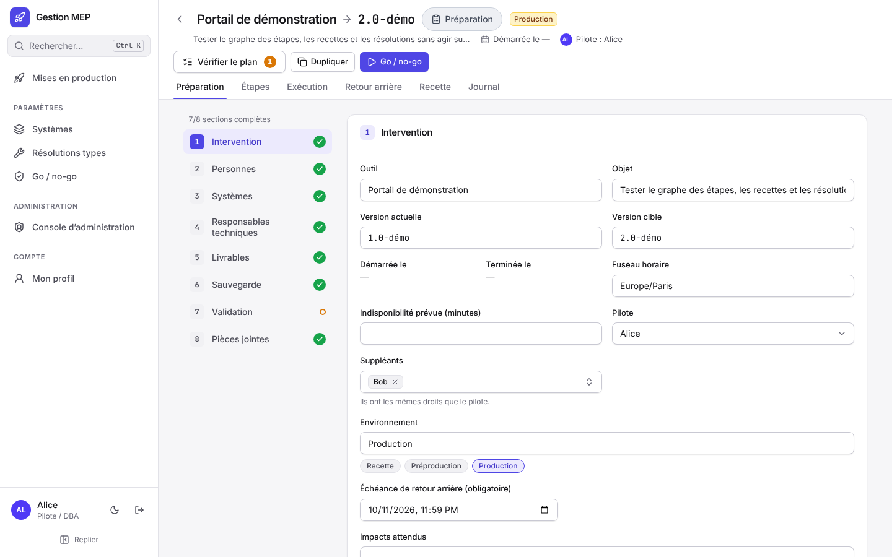
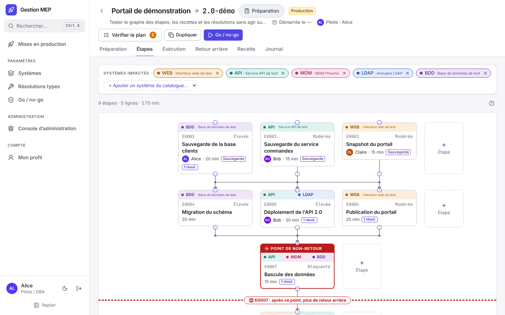
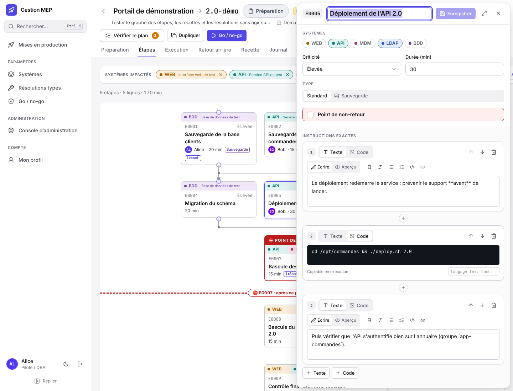
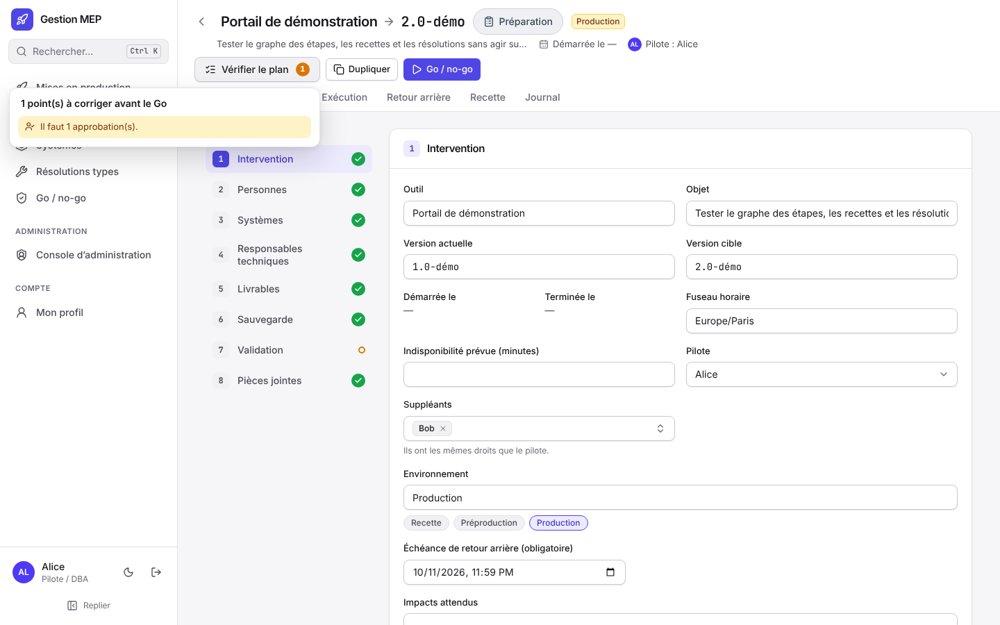
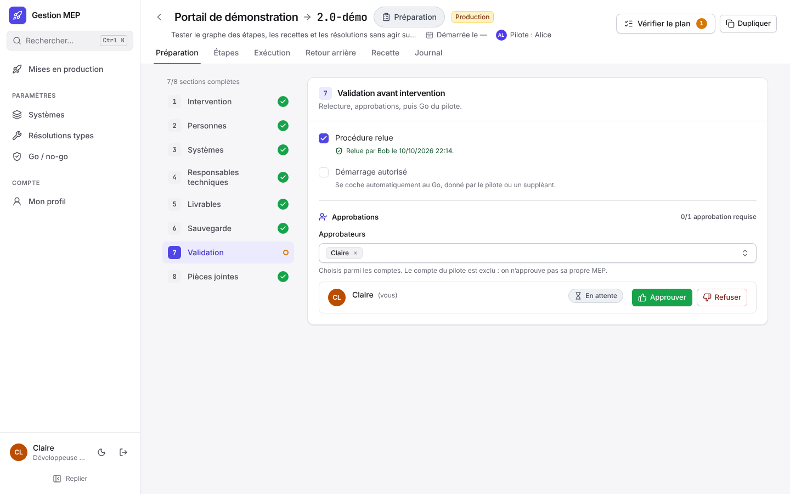

# Préparer une MEP

Cette page s'adresse aux développeurs et aux **responsables techniques** qui décrivent une intervention. L'objectif : qu'un opérateur qui n'a pas travaillé sur le changement puisse la dérouler seul, et que l'équipe sache revenir en arrière.

Peuvent modifier une MEP en préparation : son pilote, ses suppléants, ses responsables techniques et les administrateurs (voir [Droits par rôle](Droits.md)).

## Créer la MEP

Dans « Mises en production » :

- **Nouvelle MEP** : choisir le type, **MEP complète** (par défaut) ou **MEP simplifiée** (voir [MEP complète ou simplifiée](#mep-complète-ou-simplifiée)), puis saisir l'outil ou l'application concerné et l'objet de l'intervention. Le créateur devient responsable technique de la MEP (pas pilote).
- **Nouvelle MEP depuis un modèle** : choisir un modèle, puis « Créer la MEP ». Voir [Partir d'une MEP existante](#partir-dune-mep-existante).
- **Nouveau modèle** (vue « Modèles ») : comme une nouvelle MEP, mais le résultat est un modèle, toujours complet (pas de choix de type). Voir [Modèles](#modèles).

## MEP complète ou simplifiée

Une **MEP complète** est le plan détaillé décrit dans cette page. Une **MEP simplifiée** convient aux petites interventions : elle garde toutes les sections de la préparation, les tests unitaires, la recette et le [retour arrière](#retour-arrière-facultatif), mais :

- **un pilote, et toutes les autres personnes de la MEP sont ses suppléants**, avec les mêmes droits (Go, clôture, retour arrière…). Dans « Intervention », le champ « Suppléants » devient un rappel non modifiable ; dans « Personnes », chacune porte le badge « Suppléant ». Une personne ajoutée à la MEP devient suppléante ; tant qu'aucun pilote n'est désigné, il n'y a pas de suppléant ;
- **pas de version actuelle ni de version cible** pour la MEP ; les objets impactés gardent leur version ou correction livrée, et les environnements se choisissent par système et par étape comme dans une MEP complète ;
- **des étapes sans durée, sans criticité et sans résolutions liées** : ces champs disparaissent de l'édition et des fiches du graphe, et « Vérifier le plan » ne les réclame pas ; une étape modèle insérée depuis la bibliothèque arrive sans eux. Le jour J, une étape en échec propose **toutes les résolutions types des systèmes de l'étape**, regroupées par système (voir [Exécuter une MEP](Exécuter-une-MEP.md#quand-une-étape-échoue)).

Une pastille verte **« MEP simplifiée »** la signale dans l'en-tête de la MEP et dans la liste des MEP. Une MEP créée avant ce choix est complète.

Le type se change pendant la **préparation**, en haut de la section « Intervention », par le pilote, un suppléant ou un administrateur (par tout éditeur tant qu'aucun pilote n'est désigné). Enregistrer ou annuler d'abord les modifications en cours d'« Intervention ».

- **Passer en MEP complète** : tout est conservé ; les suppléants implicites deviennent des suppléants choisis (le pilote peut ensuite en retirer), les versions sont à renseigner et « Vérifier le plan » réclame la criticité de chaque étape. Le jour J, seules les résolutions liées à l'étape sont alors proposées.
- **Passer en MEP simplifiée** (MEP complète) : ce passage est **destructif**. La fenêtre de confirmation chiffre ce qui sera supprimé définitivement : durées et criticités des étapes, résolutions liées aux étapes, versions actuelle et cible, choix des suppléants (toutes les personnes sauf le pilote deviennent suppléantes). Il faut cocher « J'ai compris » pour confirmer ; repasser ensuite en complète ne fait pas revenir ces informations.

Chaque changement de type est inscrit au journal de la MEP (type `mep.type`), avec ce qui a été supprimé. Comme toute modification du contenu, il efface les approbations déjà données.

## Les onglets d'une MEP

Une MEP s'organise en quatre onglets :

- **Préparation** : la configuration de la MEP, en huit sections (ci-dessous) ;
- **Plan** : ce qui sera déroulé, en trois sous-onglets affichés sous la barre d'onglets, chacun avec son nombre d'éléments : **Étapes** (le graphe du déploiement), **Retour arrière** (sa fiche et ses étapes) et **Recette** (les fiches de recette) ;
- **Exécution** : le déroulé du jour J (absent pour un modèle) ;
- **Journal** : tout ce qui a été fait, par qui et quand.

La MEP s'ouvre sur l'onglet qui correspond à sa phase : Préparation, puis Exécution, puis Plan › Recette pendant la recette et Plan › Retour arrière pendant un retour arrière. Les anciens liens vers les onglets Étapes, Retour arrière ou Recette mènent au bon sous-onglet de Plan.

## Exporter en Excel

Chaque vue principale a son bouton **« Exporter en Excel »**, qui télécharge un classeur `.xlsx` à consulter, transmettre ou archiver. Tout utilisateur qui voit la MEP peut exporter, à toute phase. Chaque onglet du classeur porte un titre, une ligne de contexte (MEP, phase, date de l'export, filtres appliqués), des en-têtes figés et le filtre automatique d'Excel ; dates et heures sont dans le fuseau de la MEP.

| Vue | Bouton | Contenu du classeur |
|---|---|---|
| Liste des MEP (ou des modèles) | au bout de la ligne des filtres | les MEP affichées, **filtres en cours compris** (recherche, équipe, phase) : outil, version, type, phase, production, pilote, équipes, dates, avancement des étapes, retour arrière prévu |
| Préparation | sous le sommaire des sections | un onglet par section : Intervention, Personnes, Systèmes (environnements et sauvegarde par système), Responsables techniques, Objets impactés, Sauvegarde, Validation (relecture, approbations, critères du Go), Communication, Pièces jointes (la liste, pas les fichiers) |
| Plan › Étapes | au bout de la ligne de résumé du plan | une ligne par étape de déploiement, dans l'ordre du graphe : définition (systèmes, environnements, dépendances, criticité, durée, instructions, résultat attendu) puis exécution (état, exécutant, début et fin, résultat constaté, preuve, commentaire) ; un onglet des résolutions exécutées s'il y en a |
| Plan › Retour arrière | à droite du titre « Étapes de retour arrière » | la fiche du plan (dont le déclenchement éventuel), puis les étapes de retour arrière comme ci-dessus |
| Plan › Recette | en haut de l'onglet | le classeur de validation par les métiers (voir [Valider la recette dans Excel](Exécuter-une-MEP.md#valider-la-recette-dans-excel)) |
| Préparation › Objets impactés | en haut de la section | le classeur des objets, à compléter et réimporter (voir [Environnements et objets impactés](#environnements-et-objets-impactés)) |
| Journal | au bout de la ligne de recherche | les événements affichés, **filtres en cours compris** (recherche, type d'événement), puis le suivi des tests unitaires |

Seuls les classeurs de la **recette** et des **objets impactés** se réimportent ; les autres sont en lecture seule (les modifier dans Excel ne change rien à la MEP). En ligne de commande : `gestion-mep meps lister … --excel <fichier.xlsx>` et `gestion-mep meps excel <id> <vue>` (voir [Exploiter](Exploiter.md#mep-et-journal)).

## L'onglet Préparation

Il est découpé en neuf sections. Chacune affiche son état (complète ou à compléter), et un compteur indique combien sont complètes.

1. **Intervention** : type de la MEP (voir [MEP complète ou simplifiée](#mep-complète-ou-simplifiée)), outil, objet, version actuelle et version cible (MEP complète), fuseau horaire, indisponibilité prévue, impacts attendus, pilote et suppléants, case **« Plan de retour arrière »** avec, en dessous, l'**échéance de retour arrière** (facultative), et option « Bilan de clôture ». Les dates de début et de fin ne se saisissent pas : ce sont celles du Go et de la clôture. Voir [Retour arrière facultatif](#retour-arrière-facultatif).
2. **Personnes** : toutes les personnes de l'intervention. Relier chaque personne à son compte permet de pré-remplir son nom, son rôle et son contact, et lui donne le droit d'exécuter des étapes. Quand des équipes existent, le champ « Équipe » du dialogue restreint les comptes proposés. Les comptes désactivés (personnes parties) ne sont plus proposés ; une personne déjà reliée à un tel compte reste affichée, avec la mention « désactivé ».
3. **Systèmes** : les systèmes touchés, ajoutés depuis le catalogue global ou librement, et pour chacun les **environnements** concernés (un ou plusieurs : préproduction puis production, par exemple). Pour un système du catalogue, on les choisit parmi ceux de sa fiche ; pour un système ajouté librement, parmi les suggestions ou sous un autre nom. La section est complète quand chaque système a au moins un environnement. La MEP n'a pas d'environnement à elle : la liste des MEP signale « Production » dès qu'un système touche un environnement de production. Voir [Environnements et objets impactés](#environnements-et-objets-impactés).
4. **Responsables techniques** : les développeurs et sachants, avec ce qu'ils ont développé, leur disponibilité le jour J et leur contact. L'application suggère les comptes dont le profil indique une expertise sur les systèmes de la MEP.
5. **Objets impactés** : par système, puis par catégorie (tables, vues, traitements…), les objets que la MEP modifie, avec leur version ou leur correction. Voir [Environnements et objets impactés](#environnements-et-objets-impactés).
6. **Sauvegarde** : pour **chaque système**, indiquer si une sauvegarde est requise. Si oui : avant ou pendant la MEP, quoi sauvegarder, et obligatoirement l'**emplacement** de la sauvegarde et la **méthode de récupération** (comment la restaurer). Si non : une justification. Une sauvegarde faite pendant la MEP doit correspondre à une étape de type « Sauvegarde » sur ce système. S'y ajoutent les informations communes : responsable, copies, test de restauration.
7. **Validation** : relecture de la procédure, approbations, et rappel du Go.
8. **Communication** (facultative, toujours complète) : de quoi remplir les courriels de la MEP. Référence de la demande (ticket ou demande de changement), niveau de risque (non évalué, faible, modéré, élevé), bénéfices et nouveautés (un par ligne), utilisateurs impactés, case **« Arrêt applicatif »** (sa durée est l'indisponibilité prévue de la section Intervention), action attendue des utilisateurs et heure limite, **créneau annoncé** (date, heure de début et de fin annoncées aux utilisateurs ; à défaut, les textes prennent le Go et la clôture), validation par les utilisateurs (par qui, quand, et une pièce jointe de la MEP comme preuve). En dessous, la carte **Textes à copier** remplit les modèles de texte de l'équipe avec ces informations : voir [Modèles de texte](Modèles-de-texte.md). Modifier la communication ne remet pas en cause les approbations. Après le Go, le pilote, un suppléant ou un administrateur la complète encore, jusqu'à la clôture.
9. **Pièces jointes** : documents utiles (procédures, captures, scripts).

## Le plan d'étapes (Plan › Étapes)

Le plan de déploiement se dessine comme un **graphe libre**, rangé automatiquement de haut en bas :

- seuls les **liens** comptent : une étape attend ses préalables, et deux étapes qui ne s'attendent pas peuvent se dérouler **en parallèle**. Le plan ne peut pas boucler : une opération qui ferait qu'une étape s'attende elle-même, directement ou par une section, est refusée et rien ne change ;
- le **cadre du plan** tient dans la hauteur de la fenêtre : la page ne défile pas, on se déplace dans le graphe. Le bouton en haut à droite du plan (**« Plan en plein écran »**) l'affiche sur toute la page, avec le bac des sections ; **Échap** ou le même bouton en sort. Tout le plan se prépare en plein écran : « Sur cette MEP » (qui d'autre est là), les encadrés « Prénom modifie », l'espace d'édition d'une étape et son bandeau de verrou, la bibliothèque d'étapes, les messages et les fenêtres de confirmation y restent visibles, et la vue d'une section s'y ouvre (on y reste en revenant au plan). Le résumé du plan et les messages du graphe sont dans le cadre, sous sa barre d'outils. Les systèmes de la MEP se gèrent dans **Préparation › Systèmes** ;
- le **rangement** est automatique ; la **hauteur** d'une carte est donnée par ses liens (elle est sous ce qu'elle attend). Il ne bouge pas pendant qu'on glisse une carte, qu'on édite une étape ou qu'on trace un lien (la pastille « Modifications reçues » signale ce que d'autres ont changé entre-temps, rangé dès la fin de l'action), et la carte visée garde sa place à l'écran pendant que le reste glisse autour d'elle. Un ajout ailleurs ne réordonne pas le reste ;
- les **liens** sont tracés à angle droit et contournent cartes, cadres et cercles : un lien ne passe jamais derrière ou devant un élément. Les liens qui partent d'une même carte partagent leur départ, au milieu de son bord bas, puis se séparent ; ceux qui arrivent sur une même carte gardent chacun leur arrivée sur son bord haut. Le rangement cherche l'ordre des cartes qui croise le moins de liens et n'en superpose jamais deux qui n'ont rien en commun ; les coudes sont arrondis et un petit **saut** marque l'endroit où deux liens se croisent ;
- **survoler un lien** le met en avant avec ses deux bouts ; sur un tronçon partagé, tous les liens qui y passent le sont. Ouvrir une carte met ses liens en avant ; les autres s'estompent ;
- **cliquer un lien** le sélectionne (tout son tracé, tronçons partagés compris, et ses deux bouts) et ouvre son menu : **« Insérer une étape sur ce lien »** (étape vierge ou depuis un modèle) et **« Supprimer le lien »** (ou **Suppr**). Sur un tronçon que plusieurs liens partagent, le menu demande d'abord lequel (« E0001 → E0003 », « E0001 → E0004 »…, chacun mis en avant au survol). Au clavier, **Tab** atteint les liens et **Entrée** ouvre leur menu. En exécution, un clic met seulement le lien en avant ;
- **réorganiser une rangée** : glisser une carte (ou une section) à gauche ou à droite dans sa rangée, hors des liens et des cartes, change l'**ordre de gauche à droite** ; une barre bleue montre où elle ira et la pastille du bas annonce « changer l'ordre dans la rangée (les liens ne changent pas) ». L'ordre choisi vaut pour tout le monde, en direct, et le rangement le respecte ensuite. La hauteur, elle, reste donnée par les liens : on ne peut pas monter ou descendre une carte sans changer ses liens ;
- **navigation** : la molette fait défiler, **Ctrl + molette** zoome ; la barre « Vue du graphe » zoome, revient à 100 % ou « Ajuste à l'écran » ; la mini-carte, en bas à gauche, montre où l'on est (le bouton de la barre la masque ou l'affiche, choix mémorisé dans le navigateur), et « Aller à une étape » centre la carte d'un code ;
- **création rapide** : « + » sous une carte (la nouvelle étape l'attend), menu d'un lien (elle s'insère entre les deux étapes) ou « + » à côté d'une carte (en parallèle : mêmes préalables et mêmes suivants) ; le bouton **« Étape »** en haut à droite crée une étape à part, sans lien. Chaque fois, un petit menu propose **« Étape vierge »** ou **« Depuis un modèle »** : les étapes modèles les plus utilisées pour les systèmes de la MEP, ou « Parcourir la bibliothèque… », et la copie est posée à cet endroit. L'étape créée s'ouvre. Si l'étape ouverte a une saisie non enregistrée, on choisit d'abord de l'enregistrer ou non : rien n'est perdu. Un double clic ne crée qu'une étape ;
- **glisser une carte** : lâchée sur un lien, elle s'y insère ; sur une carte, ou juste **sous** une carte, elle passe après elle (la carte reçoit le lien de base, même si elle n'a aucun suivant) ; sur le **côté** d'une carte, elle se place **en parallèle** (mêmes préalables, mêmes suivants) ; sur un **cercle** de section (ou la poignée de sortie d'une section repliée), elle passe après lui. La zone d'accroche d'un lien est large et, de deux liens proches, c'est le plus proche qui est visé. Pendant le glisser, un **aperçu** en pointillé montre la place de la future carte et les liens qui seront créés, et la pastille du bas annonce ce qui va se passer (« insérer sur le lien… », « placer après E0005 (ses liens changent) », « placer en parallèle de E0005 », « changer l'ordre dans la rangée »). Elle quitte sa place sans casser le plan : ce qui l'attendait attend ce qu'elle attendait. Déplacer une étape n'ouvre pas son espace d'édition ;
- **« Optimiser les liens »** (barre d'outils, en préparation) repère les liens **inutiles** : « B attend A » alors que B attend déjà A par un autre chemin, étapes ou cercles de section compris (par exemple E0007 → Fin quand Fin attend déjà E0003, qui attend E0007). Ces liens passent en **rouge pointillé** dans le graphe et sont listés dans un bandeau : **« Confirmer »** les retire tous en une seule opération (au journal : « Liens optimisés : 2 liens redondants retirés (…) »), **« Annuler »** ne change rien. Ce que chaque étape attend, directement ou non, ne change pas : l'ordre d'exécution reste le même. Si le plan a changé entre-temps, la confirmation est refusée : relancer le calcul ;
- **tracer un lien** en tirant la poignée du bas d'une carte vers la poignée du haut de celle qui doit l'attendre (ou vers un cercle de section) ; un lien qui ferait boucler le plan, ou qui existe déjà, est refusé avec un message ;
- en haut à gauche du graphe, **« Étape modèle »** propose les étapes modèles les plus utilisées pour les systèmes de la MEP, et **« Parcourir la bibliothèque »** ouvre la [bibliothèque d'étapes](#la-bibliothèque-détapes) (voir plus bas).

### Les sections

Une **section** regroupe des étapes sous un titre (« Tables factures », « Export et téléchargement »…), avec une description et des systèmes. C'est un **repère** : elle ne s'exécute pas et ne change rien au déroulement, sinon par ses cercles.

- Une section a des **cercles** sur ses bords : d'**entrée** en haut, de **sortie** en bas. Elle naît avec « Début » et « Fin » ; on les renomme, on en ajoute (« + »), on les décrit, on les réordonne, on les supprime (les liens qui passaient par eux disparaissent).
- Un cercle d'entrée reçoit ce qui arrive de l'extérieur (une étape, ou le cercle de sortie d'une autre section) et les étapes de la section qui y sont reliées l'attendent. Un cercle de sortie attend les étapes de la section qui y sont reliées, et ce qui y est relié dehors l'attend. Une étape créée dans une section se relie toute seule au premier cercle d'entrée et au premier cercle de sortie.
- Dans le graphe, une section est un **cadre replié** (titre, systèmes, nombre d'étapes, auteur) : un clic, ou son grand bouton chevron, la déplie sur place (ses étapes dans un cadre pointillé) et « Tout déplier » / « Tout replier » agissent sur toutes.
- Dans le plan, l'**intérieur d'une section dépliée se lit seulement** : ni « + », ni glisser, ni lien à tracer ou supprimer entre ses étapes. Ouvrir une de ses cartes montre sa fiche en lecture, avec **« Modifier dans la section »**, qui ouvre la vue de la section sur cette étape. Ses cercles restent reliables depuis le plan, par leur côté extérieur : c'est ce qui relie la section au reste.
- Le **bouton crayon**, bien visible à droite du titre, ouvre la **vue d'édition** de la section ; un **double-clic** sur la section (repliée ou dépliée) aussi, et un double-clic sur une de ses étapes ouvre la vue de la section avec la fiche de cette étape. Cette vue s'affiche dans le cadre du plan (en plein écran aussi) : même graphe et même espace d'édition, limités à ses étapes et à ses cercles. Son bandeau, dans le cadre, porte **« Retour au plan »** (ou **Échap**, quand rien d'autre n'est ouvert ; le plein écran reste), le fil d'Ariane, qui d'autre y travaille, le titre, la description, les systèmes, l'auteur et les cercles : on y renomme la section, la décrit, choisit ses systèmes, gère ses cercles (un clic sur un cercle le renomme ou le supprime) et y crée et modifie ses étapes. Tant que la vue est ouverte, les autres voient « Prénom modifie » sur la section. Les sections des autres sont repliées par défaut, les siennes dépliées ; le choix est mémorisé dans le navigateur.
- **Nouvelle section** la crée dans le **bac**, le panneau à droite dans le cadre du plan (avec son propre défilement ; il se replie en une fine colonne, et se replie seul tant que l'espace d'une étape est ouvert) : on la prépare, puis on la glisse dans le graphe (ou « Placer dans le graphe ») pour la placer et relier ses cercles ; « Remettre dans le bac », dans sa vue, fait l'inverse. Une section restée dans le bac **bloque le Go** (« Vérifier le plan ») ; un cercle sans étape, ou un cercle d'entrée où rien n'arrive, donne un avertissement.
- Supprimer une section garde ses étapes, hors section, avec les mêmes préalables.
- Le jour J, une section repliée montre son avancement (« 4/7, 1 en échec »).

Plusieurs personnes peuvent préparer le plan en même temps. Ouvrir l'espace d'édition d'une étape la **verrouille** : une autre personne qui l'ouvre voit « Alice est dessus », en lecture seule, avec **« Prendre la main »**. Si elle la prend, Alice voit « Bob a pris la main », son espace passe en lecture seule et sa saisie non enregistrée reste affichée pour qu'elle la recopie. Le verrou tombe à la fermeture de l'espace, ou après une minute sans signe de vie. Le reste du graphe reste modifiable par tous. Une prise de main est annoncée à **toutes** les personnes sur la MEP (« Claire a pris la main sur E0005 à Alice ») et la carte porte l'avatar de celle qui la tient, marqué d'une main.

Cliquer une étape ouvre son **espace d'édition** :

- **action** (titre court), **systèmes** concernés et, pour chacun, le ou les **environnements** où l'étape s'exécute, parmi ceux choisis pour ce système dans la MEP (un système qui n'en a qu'un est coché d'office). La fiche de l'étape, dans le graphe et le jour J, affiche ces environnements à côté de chaque système, la production en orange ;
- **criticité**, **durée estimée** (facultative ; ni l'une ni l'autre dans une MEP simplifiée), **type** (Standard ou Sauvegarde). Une étape de type Sauvegarde indique aussi, obligatoirement, l'**emplacement** de la sauvegarde et la **méthode de récupération** ;
- **fin de l'étape** : **test unitaire** (par défaut) ou **simple vérification** (voir ci-dessous) ;
- **instructions** : blocs de texte et blocs de code. Les blocs de code s'affichent avec un bouton « Copier » le jour J : y mettre les commandes exactes ;
- **résultat attendu** : ce que l'opérateur doit constater pour déclarer l'étape réussie. Pour un test unitaire, c'est l'instruction de test ;
- **liens** : étapes préalables et étapes débloquées ;
- **résolutions types** liées à l'étape (voir plus bas ; pas dans une MEP simplifiée) ;
- **point de non-retour** : à cocher pour l'étape après laquelle on ne peut plus revenir en arrière ;
- pièces jointes de l'étape.

Les codes d'étape (`E0001` pour le déploiement, `R0001` pour le retour arrière) ne sont jamais renumérotés.

Chaque étape se termine par :

- un **test unitaire** (choix par défaut) : le résultat attendu sert d'instruction de test, et l'exécutant saisit le **résultat constaté** en terminant l'étape. On sait ainsi, après coup, quels tests ont été faits et ce qu'ils ont donné (onglet Journal, [API](API.md) et export de la MEP) ;
- une **simple vérification** : l'exécutant confirme avoir obtenu le résultat attendu, sans saisir de résultat.

Les étapes des MEP créées avant ce choix sont des tests unitaires, sans résultat constaté pour celles déjà terminées.

Le responsable d'une étape n'est pas choisi à l'avance : c'est celui qui la démarre le jour J.

## Environnements et objets impactés

Les environnements et les objets connus de chaque système sont décrits une fois pour toutes dans sa **fiche** du catalogue (Paramètres › Systèmes, voir [Administrer](Administrer.md#paramètres-partagés)). Dans la MEP :

- **Préparation › Systèmes** : choisir les environnements de chaque système. Une étape qui garde un environnement retiré du système l'affiche barré sur sa fiche, et « Vérifier le plan » le signale comme une anomalie ;
- **Préparation › Objets impactés** : un bloc par système, avec ses environnements et le décompte de ses objets (« 2 tables, 1 vue »). Chaque catégorie retenue s'affiche en tuile avec son nombre d'objets ; la sélectionner montre ses objets (catégorie, type, nom, libellé, version ou correction, précision). **« Ajouter une catégorie »** propose les catégories de la fiche pas encore utilisées, puis ouvre le choix des objets ; une catégorie absente de la fiche s'ajoute d'abord à la fiche (lien « Fiche du système »).
- **« Choisir les objets… »** ouvre une fenêtre qui liste les objets de la fiche, catégorie par catégorie (avec le nombre d'objets cochés sur le total) : recherche sur le nom, le libellé, le type et la précision, filtre par type, « Cochés » pour ne voir que la sélection, version commune à appliquer aux objets cochés, ou une version par ligne. On ne choisit que des objets de la fiche : un objet manquant s'y ajoute d'abord.
- **Excel** : « Modèle Excel » télécharge un classeur à remplir (un onglet de saisie et, à côté, les objets connus de chaque système), « Exporter » les objets déjà choisis. « Importer » ajoute ou met à jour les objets du classeur (colonnes Système, Catégorie, Type, Nom, Libellé, Précision, Version ou correction), sans rien retirer. Une ligne dont le système, la catégorie ou l'objet est inconnu de la fiche est **refusée** : rien n'est créé à sa place, et la fenêtre d'import liste chaque ligne refusée avec un lien « Compléter la fiche ».

Les livrables des MEP créées avant les objets impactés sont devenus des objets de la catégorie « Packages », marqués **« Repris »** : nom, version et emplacement sont conservés (l'emplacement dans la précision). Pour un système du catalogue, ils ont aussi été ajoutés à sa fiche, dans la même catégorie ; ceux qui n'étaient rattachés à aucun système restent visibles dans un bloc « Sans système ». L'environnement unique des MEP existantes est devenu celui de chacun de leurs systèmes et de chacune de leurs étapes, et s'est ajouté à la fiche des systèmes du catalogue.

## Le plan de retour arrière (Plan › Retour arrière)

Exigé pour le Go tant que la case « Plan de retour arrière » est cochée (c'est le défaut). Il comprend :

- la **fiche du plan** : quand déclencher le retour arrière, durée testée, version ou copies à restaurer, données créées depuis la sauvegarde, que faire si le retour arrière échoue ;
- les **étapes de retour arrière**, éditées comme celles du déploiement. Elles ne peuvent être ni point de non-retour, ni de type Sauvegarde.

### Retour arrière facultatif

Certains environnements (une préproduction qu'on réinstalle à volonté, par exemple) n'ont pas besoin de retour arrière. Dans la section « Intervention », la case **« Plan de retour arrière »** est cochée par défaut, y compris pour les MEP créées avant son apparition.

- **Échéance facultative** : sous la case, l'échéance de retour arrière peut rester vide. Sans échéance, pas de compte à rebours ni de déclenchement automatique ; le pilote peut toujours déclencher le retour arrière à la main. Renseignée, elle doit être future pour donner le Go.
- **Décocher la case** ouvre une fenêtre de confirmation qui en rappelle les conséquences ; la désactivation n'est prise en compte qu'après confirmation, puis « Enregistrer » :
  - le sous-onglet Plan › Retour arrière est masqué ; les étapes et la fiche déjà saisies sont gardées et reviennent si on recoche la case ;
  - « Vérifier le plan » ne réclame plus ni plan, ni échéance de retour arrière pour le Go ;
  - aucun retour arrière ne peut être déclenché : ni automatiquement (échéance, résolution en échec), ni à la main. Une résolution en échec laisse l'étape en échec, et le pilote décide de la suite (reprise).
- **Recocher la case** se fait sans confirmation.

L'activation et la désactivation sont inscrites au journal de la MEP, avec leur auteur et leur date. Le choix ne se modifie qu'en préparation, par un éditeur ; il est repris par la duplication et par les MEP créées depuis un modèle.

Le point de non-retour reste porté par les étapes de déploiement (voir [Cycle de vie](Cycle-de-vie.md#point-de-non-retour)).

## Les fiches de recette (Plan › Recette)

La recette vérifie, après le déploiement, que tout fonctionne. Elle est organisée par système : chaque fiche appartient à un seul système de la MEP. Dans la section de chaque système :

- **« Nouvelle fiche »** crée une fiche de ce système et ouvre sa page ;
- **« Depuis la bibliothèque »** insère une copie d'un modèle de la [bibliothèque de recettes](#la-bibliothèque-de-recettes) ; la fiche insérée se modifie ensuite librement, sans toucher au modèle.

Cliquer une fiche ouvre sa page, avec un fil d'Ariane « Recette / SYSTÈME / titre » et une adresse à partager. Avant le Go, on y rédige la fiche : un titre, puis des étapes de test. Chaque étape a un **déroulé** fait de blocs Texte ou Code (commandes, requêtes, à copier telles quelles) et un **résultat attendu** en texte simple. « Enregistrer comme modèle » ajoute la fiche à la bibliothèque.

Une fiche ne change pas de système : pour tester un autre système, créer une nouvelle fiche dans sa section. Les fiches créées avant cette règle sans système restent visibles et modifiables dans une section « Sans système », qui n'apparaît que si elle n'est pas vide ; leur page propose de les rattacher à un système, et « Vérifier le plan » le signale en avertissement.

Le jour J, les responsables techniques du système servent de contact.

## La bibliothèque de recettes

« Paramètres › Bibliothèque de recettes » rassemble des fiches de recette types, chacune rattachée à un système du catalogue : titre et étapes de test (déroulé en blocs, résultat attendu). La page s'ouvre sur le choix du système, puis la bibliothèque du système, comme la [bibliothèque d'étapes](#la-bibliothèque-détapes) ; la recherche porte sur le titre. Tout le monde peut créer et modifier un modèle, ici ou depuis la page d'une fiche (« Enregistrer comme modèle ») ; seuls les administrateurs suppriment. Insérer un modèle dans une MEP en fait une **copie** : modifier ou supprimer le modèle ensuite ne change pas les fiches déjà insérées. Un système du catalogue utilisé par un modèle est désactivé au lieu d'être supprimé.

## La bibliothèque d'étapes

« Paramètres › Bibliothèque d'étapes » rassemble des **étapes modèles** : des étapes types (sauvegarde d'une base, migration, redémarrage d'un service, contrôle final…) rattachées à un ou plusieurs systèmes du catalogue. Une étape modèle reprend la fiche d'une étape : action, systèmes, type (et, pour une sauvegarde, emplacement et méthode de récupération), criticité, durée estimée, instructions, résultat attendu, fin de l'étape et résolutions types. Elle n'a **jamais de point de non-retour** : on le coche dans la MEP, si besoin, après l'insertion.

Les trois bibliothèques (étapes, recettes, [résolutions types](#les-résolutions-types)) se présentent de la même façon :

- la page s'ouvre sur le **choix du système** : les systèmes du catalogue par ordre alphabétique, chacun avec son nombre d'éléments. Un élément qui touche plusieurs systèmes compte dans chacun. Un clic ouvre la **bibliothèque du système** (lien « tous les systèmes » pour revenir) ;
- la **recherche accepte plusieurs mots** : un mot qui est le nom d'un système limite à ce système, les autres doivent tous figurer dans le nom ou le type de l'étape (le titre d'une recette ; le titre ou les symptômes d'une résolution). Par exemple « BDD sauvegarde » donne les étapes de BDD dont le nom ou le type contient « sauvegarde ». Une ligne rappelle ce que la recherche a compris ;
- les étapes modèles se filtrent aussi **par type** (Normale, Sauvegarde) ;
- les éléments sont **triés par nombre d'utilisations**, puis par ordre de création (le plus ancien d'abord). Le compteur « N MEP » de chaque carte donne le nombre de MEP où l'élément a été inséré ou lié ; une MEP ne compte qu'une fois, et un modèle de MEP ne compte pas.

Sur chaque carte d'étape modèle : **Dupliquer** (nouvelle étape modèle préremplie), **Modifier** et, pour un administrateur, **Supprimer**. Tout le monde crée et modifie.

### Insérer une étape modèle dans le plan

Dans Plan › Étapes, deux boutons sont accolés en haut à gauche du graphe :

- **« Étape modèle ▾ »** liste les 5 étapes modèles les plus utilisées pour les systèmes de la MEP ;
- **« Parcourir la bibliothèque »** ouvre une fenêtre construite comme la page : choix du système (limité par défaut aux systèmes de la MEP, « Tous » pour voir les autres), liste triée par utilisations, aperçu de l'étape choisie, puis « Insérer une copie ».

L'étape choisie arrive **flottante** au-dessus du graphe, avec la pastille « À placer » : on la **glisse** sur un lien (elle s'y insère) ou sur une carte (elle passe après elle), ou l'on clique un « + » de carte, devenu « Poser la copie », un lien (la flèche « Poser la copie sur ce lien »), ou encore **« Poser à part »** en haut à droite. Choisie depuis le menu de création d'un « + » ou d'un lien (« Depuis un modèle »), la copie est posée tout de suite à cet endroit. **Échap** annule : rien n'est écrit tant qu'elle n'est pas posée. Une fois posée, c'est une étape ordinaire : nouveau code, liens de l'endroit où on l'a posée, pas de point de non-retour. La modifier ne change pas le modèle ; son espace d'édition rappelle « Copie de l'étape modèle « … » », sans marque sur la fiche du graphe.

Les systèmes du modèle deviennent les systèmes de la MEP issus du même système du catalogue. Si un système du modèle n'est **pas dans la MEP**, il n'est pas ajouté : l'aperçu et le message après la pose le signalent, à vous de l'ajouter aux systèmes de la MEP (Préparation › Systèmes) si besoin. Les environnements ne font pas partie du modèle : un système qui n'a qu'un environnement dans la MEP le donne à la copie ; s'il en a plusieurs, la copie arrive sans environnement pour ce système, à choisir dans son espace d'édition. Le plan de retour arrière n'accepte que les étapes modèles normales.

### Transformer une étape en étape modèle

Dans l'espace d'une étape, **« Transformer en étape modèle »** ouvre une confirmation : nom de l'étape modèle (modifiable), systèmes, ce qui est repris (action, systèmes, criticité, durée, type et sauvegarde, instructions, résultat attendu, fin, résolutions) et ce qui ne l'est pas (point de non-retour, liens, environnements, exécutant, résultats et pièces jointes). Seuls les systèmes issus du catalogue sont repris ; une étape sans système du catalogue ne peut pas devenir une étape modèle. L'étape de la MEP ne change pas.

## Préparer à plusieurs

Plusieurs personnes peuvent préparer la même MEP en même temps :

- en haut de la MEP (et dans la barre du plan en plein écran), **« Sur cette MEP : »** montre les avatars des autres personnes qui l'ont ouverte, chacune avec sa couleur ;
- l'élément qu'une autre personne est en train de modifier (une étape ouverte en édition, une section de la préparation, la fiche du retour arrière, une fiche de recette) est **encadré de sa couleur**, avec l'étiquette « Prénom modifie ». Dans le sommaire de la préparation, son avatar apparaît à côté de la section. C'est une information : rien n'est verrouillé ;
- dans le plan, chacun voit **où** sont les autres, en direct : l'avatar d'une personne apparaît sur la **carte** dont elle a ouvert la fiche (même en lecture) et sur la **section** où elle se trouve (vue de la section ou fiche d'une de ses étapes), repliée ou dépliée, dans le plan comme dans la vue de la section. Le détenteur du verrou d'une étape est marqué d'un cadenas (d'une main s'il l'a prise à quelqu'un) ; l'infobulle dit « Bob modifie sur E0003 », « Claire est dans la section « Tables factures » »… ;
- les modifications enregistrées par les autres s'affichent aussitôt, sans recharger. Votre saisie en cours est conservée : si la section que vous modifiez a changé entre-temps, un avertissement vous laisse reprendre la version à jour ou garder votre saisie ;
- une personne qui ferme la MEP (ou son navigateur) disparaît d'elle-même de la liste.

Les formulaires s'enregistrent avec leur bouton « Enregistrer ». Quitter une vue avec des modifications non enregistrées (autre onglet ou sous-onglet, autre MEP, autre page du menu) ouvre la fenêtre **« Quitter sans enregistrer ? »**, qui liste ce qui serait perdu : « Rester » revient à la saisie, « Quitter sans enregistrer » l'abandonne. Fermer ou recharger l'onglet du navigateur affiche l'avertissement habituel du navigateur.

## Les résolutions types

Une résolution type est une fiche de dépannage réutilisable pour un problème connu : symptômes, diagnostic, corrections dans l'ordre, vérification finale. Elle peut porter sur plusieurs systèmes.

- Les lier aux étapes qui risquent d'échouer, depuis l'espace d'édition de l'étape. Les résolutions des mêmes systèmes sont proposées en premier.
- « + Créer une nouvelle fiche de résolution » depuis une étape crée la fiche et la lie à l'étape.
- Toutes les résolutions sont dans « Paramètres › Résolutions types », avec l'historique de leurs versions. Tout le monde peut en créer et en modifier. La page suit le modèle des [bibliothèques](#la-bibliothèque-détapes) : choix du système (« dont N multi-systèmes » pour les résolutions qui en touchent plusieurs), puis la bibliothèque du système, qui montre aussi les résolutions valables pour tous les systèmes ; recherche sur le titre et les symptômes ; tri par nombre d'utilisations.

Une MEP simplifiée n'a pas de résolutions liées : le jour J, toutes les résolutions des systèmes de l'étape sont proposées.

Le jour J, une étape en échec propose ses résolutions liées et guide l'opérateur pas à pas (voir [Exécuter une MEP](Exécuter-une-MEP.md#quand-une-étape-échoue)).

## Vérifier le plan

Le bouton « Vérifier le plan » liste :

- les **anomalies**, qui bloquent le Go : échéance de retour arrière passée, pilote manquant ou non relié à un compte, plan de déploiement vide, plan de retour arrière vide ou sans « quand le déclencher » (si la case « Plan de retour arrière » est cochée), graphe invalide, étape incomplète (action, système, criticité, instructions, résultat attendu ; emplacement et méthode de récupération pour une étape de sauvegarde), sauvegarde non renseignée ou non justifiée, sauvegarde requise sans emplacement ou sans méthode de récupération, sauvegarde pendant la MEP sans étape de sauvegarde, étape qui garde un environnement qui n'est plus choisi pour son système, recette absente ou incomplète, procédure non relue, approbations manquantes ou refusées ;
- les **avertissements**, qui ne bloquent pas : aucun responsable technique, responsable technique absent le jour J, pilote qui est aussi responsable technique, aucun système sauvegardé, système sans recette, système sans environnement choisi.

Dans une MEP simplifiée, « Vérifier le plan » ne réclame ni criticité ni versions et n'avertit pas des résolutions manquantes (responsable technique absent) ; le pilote responsable technique n'est signalé que s'il n'y a aucune autre personne dans la MEP.

## Relecture et approbations

Dans la section Validation :

- **Procédure relue** : à cocher par une personne de la MEP reliée à un compte, idéalement un opérateur qui n'a pas écrit le plan.
- **Approbations** : les approbateurs désignés approuvent ou refusent (commentaire obligatoire en cas de refus). Le pilote ne peut pas être approbateur. Le nombre minimum d'approbations est un paramètre global (1 par défaut). Un approbateur ne peut se prononcer que lorsqu'il ne reste plus d'autre anomalie.
- Toute modification du contenu après une approbation l'efface : « Approbations à refaire ».

Quand le plan est complet, le pilote ou un suppléant donne le Go (voir [Cycle de vie](Cycle-de-vie.md#go--no-go--passage-en-exécution)).

## Partir d'une MEP existante

- **Dupliquer** (bouton de la liste ou de l'en-tête) copie une MEP : identité, personnes, pilote et suppléants, systèmes avec leurs environnements et leur sauvegarde, responsables techniques, objets impactés, étapes (avec leurs environnements) et liens, résolutions liées, plan de retour arrière (et le choix de l'avoir ou non), fiches de recette (sans les résultats) et approbateurs (sans leurs décisions). La communication est copiée (niveau de risque, bénéfices, utilisateurs impactés, arrêt applicatif, action attendue et heure limite), sauf la référence de la demande, le créneau annoncé et la validation par les utilisateurs. Ne sont pas copiés : l'échéance, la relecture, le Go, les résultats d'exécution (dont les résultats constatés des tests unitaires), le bilan et les pièces jointes. La copie garde le type (complète ou simplifiée) ; un modèle, lui, est toujours complet : copier une MEP simplifiée en modèle en fait un modèle complet, dont les suppléants implicites deviennent des suppléants choisis.
- Cocher **« En faire un modèle »** à la duplication crée un modèle, à réutiliser avec « Nouvelle MEP depuis un modèle ».

## Modèles

Un modèle se prépare comme une MEP (intervention, personnes, systèmes, responsables techniques, objets impactés, sauvegarde, étapes, retour arrière, fiches de recette, approbateurs, pièces jointes), mais il ne s'exécute jamais. Ce qui se décide pour chaque intervention n'y apparaît donc pas :

| Masqué dans un modèle | Où le renseigner |
|---|---|
| Phase, dates de démarrage et de fin | Fixées par le Go et la clôture de la MEP |
| Pilote et suppléants | Section « Intervention » de la MEP |
| Échéance de retour arrière | Section « Intervention » de la MEP |
| Disponibilité le jour J des responsables techniques | Section « Responsables techniques » de la MEP |
| Date de réalisation de la sauvegarde, test de restauration | Section « Sauvegarde » de la MEP |
| Relecture de la procédure, démarrage autorisé, décisions d'approbation | Section « Validation » de la MEP (les approbateurs, eux, se choisissent dans le modèle) |
| Bouton Go / no-go et onglet Exécution | MEP en préparation, puis en exécution |

Un modèle est toujours une MEP complète, et une MEP créée depuis un modèle l'est aussi ; elle peut ensuite passer en simplifiée pendant sa préparation.

« Vérifier le plan » ne réclame dans un modèle ni échéance, ni pilote, ni relecture, ni approbation. Le bouton **« Créer une MEP depuis ce modèle »**, en haut du modèle, crée la MEP et l'ouvre.
